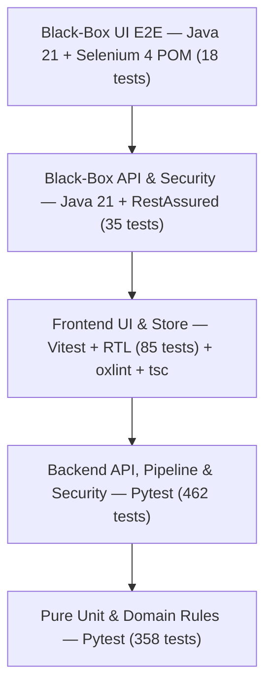

# SubBuild Studio 🎬

**SubBuild Studio** is a local desktop app for automated video subtitling: high-precision Speech-to-Text transcription with word-level timing, broadcast-grade subtitle refinement, and context-aware batch translation powered by multiple AI providers — **Google Gemini**, **OpenAI GPT**, **Anthropic Claude**, and **Ollama (Local / Cloud)** — with first-class RTL/Hebrew support.

It is built for people who make or work with video: **content creators** (YouTube, podcasts, courses, interviews), **translators and subtitling studios** who want a timed, translated first draft to polish, **accessibility** work (subtitles for deaf and hard-of-hearing viewers), and **organizations** subtitling training videos and recordings. Video and audio never leave your computer.

🌐 **Website:** [subbuildstudio.com](https://subbuildstudio.com) · ⬇️ **Windows installer:** [SubBuild-Studio-Setup.exe](https://github.com/talevi83/SubBuildStudio/releases/latest/download/SubBuild-Studio-Setup.exe) · 🍎 **macOS:** [Apple Silicon](https://github.com/talevi83/SubBuildStudio/releases/latest/download/SubBuild-Studio-macOS-AppleSilicon.dmg) / [Intel](https://github.com/talevi83/SubBuildStudio/releases/latest/download/SubBuild-Studio-macOS-Intel.dmg) · 🐧 **Linux:** [AppImage](https://github.com/talevi83/SubBuildStudio/releases/latest/download/SubBuild-Studio-Linux-x86_64.AppImage) · 🔒 [Privacy policy](https://subbuildstudio.com/privacy) · ✍️ [Code signing policy](https://subbuildstudio.com/code-signing)

---

## ⬇️ Getting SubBuild Studio

- **Windows (recommended for most people):** download [`SubBuild-Studio-Setup.exe`](https://github.com/talevi83/SubBuildStudio/releases/latest/download/SubBuild-Studio-Setup.exe) and run it. No Python, Node.js or terminal needed; the first install downloads the AI components once. See [Windows Installer](#-windows-installer-subbuild-studio-setupexe).
- **macOS:** download the disk image for your Mac — [Apple Silicon (M1 and later)](https://github.com/talevi83/SubBuildStudio/releases/latest/download/SubBuild-Studio-macOS-AppleSilicon.dmg) or [Intel](https://github.com/talevi83/SubBuildStudio/releases/latest/download/SubBuild-Studio-macOS-Intel.dmg) — and drag *SubBuild Studio* to Applications. Everything is included; nothing else to install. See [macOS App](#-macos-app-dmg).
- **Linux (x86_64):** download [`SubBuild-Studio-Linux-x86_64.AppImage`](https://github.com/talevi83/SubBuildStudio/releases/latest/download/SubBuild-Studio-Linux-x86_64.AppImage), allow it to run (right-click → *Properties* → *Allow executing file as program*, or `chmod +x`) and open it. It adds itself to the applications menu; on a PC with an NVIDIA card it offers the GPU libraries as a one-time download. See [Linux AppImage](#-linux-appimage).
- **Running from source on Windows / macOS / Linux:** download the source code of the [latest release](https://github.com/talevi83/SubBuildStudio/releases/latest) (or clone the repository) and run `install.bat` / `./install.sh` once, then `run.bat` / `./run.sh`. See the [Quickstart Guide](#-quickstart-guide).

The two ways are independent: an installed copy keeps its data in `%LOCALAPPDATA%\SubBuild Studio` (Windows), `~/Library/Application Support/SubBuild Studio` (macOS) or `~/.local/share/SubBuild Studio` (Linux), a source copy in `backend\`.

## ⚖️ Intended Use

SubBuild Studio is meant for video you have the right to work on: videos you made, client material you were asked to subtitle, or content you are licensed to translate. It does not download or share video, and how content is used is the responsibility of the person using it.

---

## 🌟 Key Features

1. **Unified Zero-Copy Local Ingest, Stream Discovery & Embedded Subtitle Extraction:**
   - **Unified Ingest Dropzone & Path Input:** Drag & drop a video file directly onto the studio, click to browse, or paste a local path in one unified view.
   - **Recommended — Use the Desktop App Window (`run.bat` / `./run.sh --window`):** In the desktop window (Edge WebView2 / `pywebview`), dragging & dropping a video or clicking to browse resolves the file's **direct local path** on disk (`CoreWebView2File.Path` / native file dialog) without uploading or copying a single byte to temp, and preserves the video's folder for **Save next to video**.
   - Right-click the path field for a one-item **Paste** menu (also works in the desktop window, where it reads the clipboard through the app).
   - Discovers all video, audio, and embedded subtitle tracks via `ffprobe` and lets you select the exact audio or text-based dialogue subtitle stream to use.
   - **Use Embedded Subtitles Toggle (`use_embedded_subtitles`):** When the video has an embedded text-based dialogue track (e.g., SRT/ASS/WebVTT inside an MKV), SubBuild extracts it directly for instant, studio-accurate timing without waiting for full Whisper transcription — or you can switch it off to force fresh Whisper transcription from the audio.
   - **Supplement with Whisper (`supplement_with_whisper`):** Optionally run Whisper alongside embedded or synced subtitles (`pipeline/missing_speech.py`) to detect and recover spoken lines missing from the subtitle track (such as unsubtitled radio chatter, background remarks, or foreign phrases) without duplicating existing lines.
   - **Smart Workflow Presets (`GenrePresets`) & Section Filter Tabs:** One-click preset selector at the top of the configuration panel (`▶️ YouTube / Long-form`, `🎙️ Podcast / Interview`, `📱 Reels / TikTok / Shorts`, `🎓 Courses & Tutorials`, `🔬 Documentary & Explainer`, `🇮🇱 Hebrew Audio (HE → HE)`) that automatically configures the Whisper model (including `ivrit-ai/whisper-large-v3-turbo-ct2` for Hebrew), Smart Audio Map, Voice ID diarization, OCR sensitivity, and translation settings for that workflow, with live active-preset detection, a `Custom` badge when tweaked manually, and quick section tabs (`All Sections`, `Transcription & Audio`, `Translation & Cost`).
   - **Browser fallback:** If opened in a regular external browser (`--browser`), where web security blocks local path resolution, dropped files automatically fall back to upload with progress reporting, de-duplication (same name + size is reused), and automatic cleanup when the project is deleted.

2. **Hardware-Accelerated Transcription (`Faster-Whisper` & `WhisperX`), Smart Audio Map & Selective Vocal Isolation:**
   - **Dual Transcription Engines (`transcription_provider`):**
     - **`Faster-Whisper` (default, CTranslate2):** Fast, lightweight inference with automatic hardware detection (`CUDA FP16` on NVIDIA GPUs or `CPU INT8`), batched GPU inference (`WHISPER_BATCH_SIZE`) with automatic OOM fallback to sequential decoding, `large-v3-turbo` and the dedicated Hebrew specialist model `ivrit-ai/whisper-large-v3-turbo-ct2`. The model stays loaded between jobs; jobs queue for the GPU instead of loading two models at once.
     - **`WhisperX` (`providers/transcription/whisperx_provider.py`, optional):** Combines batched VAD Whisper ASR with `wav2vec2` phoneme forced alignment for frame-accurate word timestamps, isolated phantom-interjection filtering (`filter_phantom_interjections`), and immediate per-step VRAM release so 8 GB GPUs stay well within memory limits (automatically falls back to Faster-Whisper if not installed).
   - **Smart Audio Map & Selective Window Conditioning (`services/smart_audio_map.py`, `stages/vocal_isolation_stage.py`, `services/audio_isolation.py`):**
     - Scans the entire 16 kHz soundtrack in a fast vectorized pass (~1–2 seconds on CPU for a 2-hour movie) to map its acoustic timeline before transcription and activate filters **only on the specific time windows that need them** (`off` / `auto` / `on` for `vocal_isolation_mode` and `comms_boost_mode`):
       - **Whisper windows (`whisper`):** Faint or whispered speech (`-48..-25.5 dBFS` adapted to the soundtrack's 88th-percentile dialogue loudness with sibilant/formant presence) receives localized soft speech gain (up to `+9 dB`) without cutting high-frequency consonants.
       - **Music-masked windows (`music_masked`):** Speech buried under sustained broadband music or heavy sound effects triggers selective **Demucs (`htdemucs`) / `audio-separator`** vocal separation **only on those masked windows** (taking seconds instead of hours). Full-file vocal isolation (`on`) is also available in Advanced Audio Settings with deterministic source caching (`storage/vocals/`).
       - **Comms windows (`comms`):** Band-limited walkie-talkie/radio speech receives localized radio bandpass, spectral hiss reduction, and gentle compression.
     - **100% Untouched Clean Speech & Raw Audio Preservation:** Every sample outside detected windows stays **100% untouched (`OFF`)**, window boundaries are blended with an 80 ms raised-cosine crossfade so VAD never sees splice clicks, and acoustic speaker diarization (`WeSpeaker`) plus voice-pitch gender estimation (`F0`) always read the original unconditioned audio (`ctx.raw_audio_wav_path`).
   - **Context / Glossary / Names Prompt (`initial_prompt`):** Optional field in Setup that feeds character names, proper nouns, domain terms, or a brief synopsis into both Whisper speech recognition and the AI translation glossary.
   - Silero VAD, `condition_on_previous_text=False` and loop detection against hallucinated repetitions.
   - **High Speech Sensitivity (`high_speech_sensitivity`):** Optional per-job toggle (enabled automatically when Smart Audio Processing is on) that relaxes VAD and decoding thresholds to catch quiet whispers, murmurs, and speech partially buried under music or sound effects.
   - Surround (5.1/7.1) tracks are downmixed with emphasis on the dialogue centre channel (boosting center speech while attenuating LFE/surround noise).
   - Cancel really stops Whisper mid-file.

3. **Broadcast-Grade Subtitle Refinement, Smart End-Credits Detection, Speaker Split & SDH Cleaning:**
   - Re-segments Whisper's output by sentence: lines Whisper cut mid-sentence are re-joined, dangling one-word fragments are merged, and sentences from different Whisper segments are never glued together (avoids mixing speakers).
   - **Smart End-Credits Detection & Post-Credits Scene Preservation (`skip_end_credits`, `pipeline/credits_detect.py`):** Automatically detects and skips end-credits rolls, cast/crew cards, and closing songs (including punctuated hip-hop/rap lyrics) in the tail of the video using container chapter markers (`ffprobe -show_chapters`), visual thumbnail analysis of dark scrolling credit screens (`thumbs.raw`), and text/dialogue clustering — while preserving mid-credits and post-credits dialogue scenes and narrative title cards (`[ONE YEAR LATER]`, `[MEANWHILE...]`).
   - **Multi-Speaker Turn Splitting & SDH Cleanup (`utils/speaker_split.py`):** Automatically detects and formats multi-speaker dialogue turns with standard dialogue dashes (`- ...`), and offers a **Clean Hearing-Impaired (SDH) Tags (`remove_sdh_speakers`)** toggle per job in the post-video Setup screen (also controlled by **Genre Presets**) that strips speaker labels (`JOHN:`, `[MAN]`) and sound-effect cues (`(sighs)`, `[door slams]`) from spoken dialogue while preserving genuine `[ON_SCREEN]` titles.
   - Long sentences are split at clause boundaries/pauses, max 42 characters per line and 2 lines per subtitle.
   - Timing pass: no overlaps, ≥2-frame gaps, display time extended toward a target reading speed (`TARGET_CPS`), short gaps closed to avoid flicker.
   - Reading speed (CPS) badges, plus a categorized problem filter (`All problems`, `Untranslated / failed`, `Leftover English in translation`, `Fast reading speed / CPS`) and segment tag filter in the editor.

4. **Context-Aware Multi-Provider Subtitle Translation (Google Gemini, OpenAI, Anthropic, Ollama):**
   - Mix and match providers per stage (*Translation*, *Glossary pass*, *On-screen OCR/Vision*) or keep one provider across the whole pipeline (e.g., local Ollama for Translation + Gemini Flex / GPT-5 nano for frame OCR).
   - **Model-Aware Batch Sizing, Per-Stage Thinking Budgets & Static Prefix Caching:** Automatically tunes batch sizes (`35` lines for capable cloud models; tuned smaller batches for local/compact models) with adaptive splitting, structured JSON schema validation (`core/provider_catalog.py`, `providers/llm/client.py`), per-stage thinking token budgets, and static system/glossary prompt prefix caching so scoped row hints never invalidate the cached prefix.
   - **Dedicated On-Screen Translation Pass:** `[ON_SCREEN]` cues (burned-in signs, location chyrons, HUD telemetry, text messages) are translated in a separate pass with a dedicated sign/title prompt from spoken dialogue (`DIALOGUE` / `COMMS` / `FOREIGN`), preventing sign text and overlapping dialogue from contaminating or overwriting each other during translation.
   - One glossary pass over the whole transcript (characters, gender, terminology — merged with any user-supplied `initial_prompt` / context glossary pairs) feeds translation, with per-batch dynamic glossary pruning (main cast + characters and terms appearing in the active window, including active `speaker` and `addressee` characters) so prompts stay compact without mutating the saved glossary.
   - **Acoustic Speaker Diarization, Long-Film Cluster Re-Split & Character Matching (`enable_diarization`, `pipeline/diarization.py`, `pipeline/speaker_match.py`):** Local zero-token WeSpeaker CAM++ ONNX voiceprint clustering tags `SPEAKER_XX` turns across the timeline (retroactively or during pipeline runs), automatically re-splits oversized merged voice clusters on long films (`>= 45 min`), cross-references conversational clues and AI matching (with a 16k output token budget) to link voice clusters with glossary characters, and quarantines unreliable clusters via an automated diarization quality guard (`assess_diarization`). Supports merging/re-assigning cast voices in the **Characters, Speakers & Terms** studio modal. Each speaker's **gender is estimated from voice pitch** (`pipeline/voice_gender.py`: median F0 over their turns on raw unconditioned audio; under ~155 Hz male, ~170–300 Hz female, the overlap zone and child-like voices stay unknown) and refined by dialogue context (1st-person self-descriptions, vocatives, and honorific replies), so Hebrew/Arabic get the right gender even when no name or pronoun is spoken. A voice estimate never replaces a gender from the transcript (glossary / character matching), and the listener resolver trusts it a little less than one. In short clips a voice with a single utterance keeps its own cluster instead of being absorbed as noise.
   - **Speaker vs. Addressee (Listener) Gender & Plurality Resolution (`pipeline/addressee.py`):** Automatically distinguishes **who is speaking** (`speaker`, used solely for 1st-person self-reference such as *"אני הולכת"*) from **who is being spoken to** (`addressee`, used for all 2nd-person forms: masculine singular *"אתה"*, feminine singular *"את"*, or plural *"אתם/אתן"* / `group (plural)`). Every dialogue line gets a structured listener record with a **confidence score**: direct evidence in the line (plural/group phrases such as `"you guys"` / `"everyone"`, named character vocatives, honorifics such as `"sir"` / `"ma'am"` / `"Mr./Mrs./Ms."`), **conversation state & scene continuity** (the dialogue is cut into exchanges at silences over 8s; a speaker keeps talking to the same listener, carrying strong evidence and scene addressee gender continuity to neighbouring lines with decaying confidence, and dropping it when a third person speaks in between), and turn-taking (two-person exchanges, replying to whoever just called you by name, question/answer adjacency). The confidence decides what the translator is told: a fact (`addressee`), a guess it may overrule from context (`addressee_guess`), or nothing — a weak guess is never presented as certain. For Hebrew/Arabic the translator also reports which 2nd-person form it wrote (`addressee_form`); lines that contradict a confident listener are **translated once more** (`ADDRESSEE_AUTOFIX`, one extra request, at most `ADDRESSEE_AUTOFIX_MAX_ROWS` lines) and anything still wrong is flagged by the quality check. The record is stored on each row (`addressee_json`) and shown in the Studio table as a read-only *Speaking to* tag: grey when sure, dashed amber when the app could not settle a line that has a "you" or an imperative (filter: *Unclear who is being spoken to*), indigo with a lock when you set it yourself (tick rows → *Speaking to a woman / man / group*) — a manual pick is kept by later translations and guides the lines around it.
   - **Metric System Conversion Toggle (`convert_to_metric`):** Optional per-job setting in the Setup screen (and Genre Presets) to automatically convert imperial measurements (miles, feet, inches, lbs, Fahrenheit, gallons, acres) into natural, idiomatic metric equivalents (km, m, kg, Celsius, liters, dunams) with natural rounding while preserving figurative idioms.
   - Missing lines are retried individually; anything that still fails is **flagged**, never silently left in English. "Retranslate failed" / "Retranslate all" (or a different target language) without re-transcribing.
   - Subtitles are saved as soon as they're refined and after every translated batch — nothing is lost if translation fails.

5. **Bidirectional RTL Punctuation Safety (Hebrew & Arabic):**
   - Text is stored clean; Unicode Right-to-Left Marks (`\u200f`) are added at export so `?`, `!` and dialogue hyphens land on the correct side in VLC, media players and HTML5 (browser) players. SRT files are written with a UTF-8 BOM for player compatibility.

6. **📻 Tactical Comms & Radio Boost (optional, per job):**
   - Extracts audio through a speech-band filter chain (180Hz–3.8kHz, FFT denoise, compressor, `dynaudnorm`) so faint or distorted walkie-talkie traffic and whispers survive.
   - Whisper runs with a permissive VAD, relaxed `no_speech`/`log_prob` thresholds and a tactical vocabulary prompt (`initial_prompt` + `hotwords`).
   - Radio-procedure lines ("Copy that, over.", "Do you copy?", "…come in.") are tagged `COMMS` and translated with authentic IDF radio phrasing ("רות", "עבור").

7. **📺 On-Screen Text, Sensitivity Levels, GPU Frame Sampling & Live Positioning:**
   - Uses an embedded forced/"signs" text subtitle track when the file has one.
   - Otherwise samples video frames in the background while Whisper transcribes. Sampling is GPU-accelerated (`-hwaccel auto` via NVDEC/D3D11VA) and demuxes only keyframes (`-discard nokey`) on long videos, completing 36-minute 1440p 60fps AV1/HEVC scans in ~29 seconds instead of 20+ minutes on CPU.
   - **3-Level On-Screen Sensitivity (`onscreen_sensitivity`):** Choose between **1 — Strict (Titles Only)** (major location/time cards, ~3s intervals, max 360 frames), **2 — Balanced** (narrative signs, chyrons, and important on-screen text, ~2s intervals, max 660 frames), or **3 — Broad / Maximum** (dense sampling every 1s up to 1,200 frames + scene cuts to catch brief text messages, handwritten notes, documents, and HUD details).
   - Repeated detections are merged into one `[bracketed]` `ON_SCREEN` subtitle with stable appearance/disappearance boundaries and woven into the timeline. Lone short words (HUD/radio callsigns like "EAGLE") are dropped, and signs returning within 3 minutes are not repeated.
   - **Speech Overlap & Comfortable Reading Time (`allow_onscreen_overlap`):** On-screen titles (chyrons, speaker roles/credentials) can appear concurrently with bottom dialogue lines (`allow_onscreen_overlap=True` by default) or be sequenced without overlap. On-screen cues enforce a minimum 3.0-second display duration (scaled up for longer text) so viewers can comfortably read both the sign and the dialogue.
   - **Live Screen Position Selector (`onscreen_position`):** Choose where on-screen translations appear (`Top Center \an8`, `Center \an5`, `Center Right \an6`, `Center Left \an4`, `Top Right \an9`, `Top Left \an7`) per job in Ingest (Setup screen) or **live inside the Studio editor toolbar** (`PATCH /api/jobs/{id}/settings`) without re-running the job. The HTML5 video player renders separate top/middle and bottom subtitle layers simultaneously, and exports serialize standard SubStation Alpha `{\anX}` tags in SRT and cue positioning in WebVTT.
   - **Speech in other languages** (e.g. a guest switching to Russian in an English interview): passages in another language are detected, sampled from the bottom third with GPU acceleration, and read from burned-in subtitles (or re-transcribed by Whisper).

8. **Interactive Studio Workspace, Waveform Timeline, Virtualized Editor & Project Management:**
   - Split-screen workspace with synced HTML5 video player (HTTP Range seeking), dual-layer subtitle overlay (simultaneous dialogue + positioned on-screen cues), seek bar, and fullscreen.
   - **Interactive Dual-Lane Audio Waveform Timeline (`WaveformTimeline.tsx`):** Displays audio amplitude peaks (`50 peaks/s`) with zoom levels (`6s`–`60s`, buttons or mouse wheel), separate lanes for dialogue and `[ON_SCREEN]` cues, direct block move and edge-resize dragging (clamped cleanly to same-lane neighbours and persisted as a single Undo/Redo step on release), horizontal drag-to-seek, and a **live drag HUD overlay (`waveform-drag-overlay`) + canvas seek-range highlight** showing the target timestamp/time range and signed delta (`+`/`-` seconds) in real time while dragging.
   - **60fps Virtualized Subtitle Table:** Windowed table rendering keeps only the visible viewport rows (+ overscan buffer) mounted in the DOM, paired with deferred search filtering (`useDeferredValue`) and primitive playhead index subscriptions so 2,500+ line, two-hour recordings scroll and edit with zero lag.
   - **Quick Jump & Fast Range Selection:** Jump directly to any line number (`#1850`) or timestamp (`1:15:00`) from the table toolbar, jump to the top/bottom of the list in one click, or select all rows from row `#X` to the end (or from the start to `#X`) via the row action button, `Alt+Click` on a checkbox, or the selection bar.
   - Keyboard: `Space` play/pause, `←/→` ±2s (`Shift` ±0.1s), `[` / `]` set the subtitle start/end to the playhead, `N` add a line at the playhead, `F` fullscreen, `Ctrl+Z` / `Ctrl+Y` undo / redo.
   - **Add, Delete & Bulk-Delete lines:** *Add line* above the table (or `N`) opens it at the playhead, the `+` under a row number right after that row. Select individual rows, Shift-click a range, expand selection to the end, or use the **Select All checkbox** in the table header to bulk re-translate or bulk delete (`DELETE /api/jobs/{id}/segments`) selected subtitle rows with automatic renumbering.
   - **Bulk Project Deletion & Clear All (Sidebar):** Select multiple projects in the sidebar or click **Clear All** to delete finished jobs, their cached audio/frames/logs, and their owned uploads in one action (`POST /api/jobs/bulk-delete`, `DELETE /api/jobs`).
   - **Filter by Tag & Categorized Problems:** Dedicated tag filter dropdown (`ON_SCREEN` 📺, `COMMS` 📻, `FOREIGN` 🌐, or any tagged cue) and categorized problem filter (`All problems`, `Untranslated / failed`, `Leftover English in translation`, `Fast reading speed / CPS` — also clickable directly from the bottom warning badge).
   - Inline editor with debounced auto-save, ±100ms nudges, and bulk Search & Replace (with Regex toggle).
   - **Undo / Redo & History panel (Photoshop-style):** every change — typing in a line, timing, Replace All, adding/deleting/moving lines, *Re-check timing*, re-translations — is a step. `Ctrl+Z` / `Ctrl+Y` (or `Ctrl+Shift+Z`, any keyboard layout) undo and redo; the **History** panel lists all steps with their time, highlights the current one and jumps to any of them. Steps after the current one stay (dimmed) until you make a new edit. Typing in one line counts as one step, and the history is saved with the project, so it survives a restart (the newest 100 steps are kept).
   - Export to `.srt` or `.vtt`, named so players and platforms pick them up (e.g. `Video.he.srt`).
   - **Save next to video:** one click writes the translated `.srt` straight into the video's own folder (`Video.he.srt` beside `Video.mp4`), ready for VLC and other players or for uploading to YouTube. An existing file is only replaced after you confirm; not available for browser uploads, which have no folder of their own.

9. **⏱ Sync Existing Subtitles (+ Optional Whisper Supplement):**
   - Choose **Sync my subtitles** on the setup screen, pick the video and a subtitle file you already have (SRT, WebVTT or ASS, in any language and encoding: UTF-8/UTF-16/Windows-1255 Hebrew files are read correctly). The existing text is never changed, only the timing.
   - Matches speech rhythm (Silero VAD + Whisper word times), embedded/burned-in tracks, and AI translation anchors.
   - Optionally enable **Supplement missing speech with Whisper** and **On-screen OCR** during sync so any untranscribed spoken lines or burned-in signs missing from your subtitle file are automatically transcribed, translated, and merged into the synced timeline.

10. **💡 Cost-Saver Mode & Local AI Offloading (Optional Toggle):**
    - **One simple toggle** in Settings (`cost_saver_mode`, off by default to protect weak laptops).
    - **Local frame pre-filtering:** Pillow-based edge detection and 64-bit difference hashing (`dHash`) filter out blank/textless frames and merge consecutive identical title cards before calling Vision AI, saving ~75–80% of Vision image tokens.
    - **GPU VRAM unloading:** Unloads Faster-Whisper from GPU memory right after transcription completes so 8GB GPUs have free VRAM for local LLMs or system tasks.
    - **Zero-config local gender pre-tagging (Ollama):** Auto-detects local Ollama (e.g. `qwen2.5:7b`) and asks it only about the lines the rule-based listener resolver left open — 2nd-person pronouns, imperatives (`"Come here."`) and 1st-person self-references whose listener / speaker gender is still unknown. Each asked line is sent with the dialogue around it (who was named, who answers) and with the listeners already settled, and the answer `[Speaker: M/F/?, To: M/F/G/?]` (including `G` for plural group addressees) is treated as a second opinion: a guess on its own, a confirmation of a matching guess, never an override of a confident or manual listener. Hebrew/Arabic only; silently skips with zero delay if Ollama is not installed.
    - **One-click Ollama setup:** Settings screen includes live Ollama status, a link to the official Ollama download (the app never downloads and runs an installer itself), one-click daemon startup / model pull once Ollama is installed (`POST /api/settings/ollama/setup`), and instructions for advanced users.

11. **📊 Live & Post-Run Token & Local AI Savings Summary:**
    - Live monitoring bar in the studio and final run summary shows:
      - Breakdown of tokens and cost used per AI provider/model (specifying the exact provider/model and input/output/thinking counts).
      - Local AI queries sent to Ollama and model name.
      - Tokens and video frames saved locally by Cost-Saver pre-filtering.

12. **❓ Dedicated Help, User Guide & Q&A Screen:**
    - Dedicated **"Help & Q&A"** button in the sidebar bottom panel opens a comprehensive standalone guide.
    - 4-step quick-start workflow overview (Media Ingest, Configuration, Live Monitoring, Review & Export).
    - Interactive FAQ accordion covering Whisper model choices, Comms Boost, Cost-Saver Mode, Hebrew gender rules, multi-provider AI models (Gemini, OpenAI, Anthropic, Ollama) and Google Flex mode, timing fixes, and video player codec compatibility.

---

## 🎛️ Studio Quality, Timing & Gender Tools

Tools available inside the interactive Studio Editor and Whisper refinement pipeline:

- **Missed-speech recovery** (on by default, `WHISPER_GAP_RECOVERY=false` to disable): the voice detector (Silero VAD) misses speech under gunfire, engines, music and radio filtering, so Whisper never hears it. After transcription, Whisper re-listens *without* VAD to every stretch no subtitle covers and keeps only lines that pass strict hallucination checks; each kept/rejected line is listed in the project log. Shouted commands ("Fire!", "Go, go, go!", "Cease fire!") are judged by their own words rather than the noisy window's confidence, and repeats of a neighbouring command are kept.
- **Subtitle start alignment** (on by default, `WHISPER_SNAP_STARTS=false` to disable): Whisper's word timestamps ignore silence, so a word that follows a pause is stamped right after the previous word and the subtitle can appear a second or two before anyone speaks. After transcription, Silero VAD finds where speech really begins and any word that spans a silent gap (0.4s or longer) is moved to just before the speech that follows it (starts are only ever moved later, and speech the detector misses is left as Whisper timed it). The job log shows how many word starts were moved.
- **Re-check timing (finished jobs)**: the *Re-check timing* button above the table re-extracts the audio, runs voice-activity detection over the whole video and moves every subtitle that starts in a silence shortly before speech to just before that speech (text and on-screen cues are never touched; there is an *Undo* right after). Results are cached in `storage/regions`. The API is `POST /api/jobs/{id}/retime`.
- **Drag to reorder**: drag a row by the handle in the `#` column to another row. The text moves, the time slots stay, and only the rows between the two positions are re-checked against the audio of that section (a subtitle sitting in silence is moved to the speech that follows it). Disabled while a search or the problems filter is active, and while the job runs. The API is `POST /api/jobs/{id}/segments/move`.
- **Click a row to play**: clicking a subtitle row jumps the video to 1.5 seconds before that subtitle and starts playing, so you hear the lead-in (never earlier than the start of the video).
- **Gender and who is being spoken to:** Automatic acoustic diarization (`diarization.py`) and the listener resolver (`pipeline/addressee.py`) track both who is speaking (1st-person) and who is being addressed (2nd-person singular/plural via vocatives, honorifics, conversation state and turn-taking) across every batch. Each row shows its *Speaking to* tag (read-only). To correct it, tick the checkbox next to a few rows (Shift-click for a range) and use *Speaking to a woman / man / group*, or *Re-translate with a note...* to also set the speaker's gender and add free text (optionally remembered in the job's context notes). Only the selected rows are translated again, with the note as a top-priority instruction (`POST /api/jobs/{id}/translate` with `segment_ids`, `speaker_gender`, `addressee_gender`, `hint`); the chosen listener is saved on those rows as a manual tag.
- **Characters & terms editor**: the *Characters & terms* button opens the glossary the translator was given (gender, name spelling, terms, tone). Fix it, save, and optionally re-translate everything. The API is `PUT /api/jobs/{id}/glossary`.
- **Series glossary profiles**: give a series a name (a channel, a course, a podcast or a show; in the setup screen, or in the *Characters & terms* window) and its people, genders, name spellings and terms are saved under `storage/glossaries/`. Later episodes that use the same name start from that list (it is treated as authoritative), the glossary pass only adds characters and terms that are new, and the profile grows with every episode. The API is `GET /api/glossary-profiles`.
- **Check quality**: a button above the table scans the translation without calling any model and lists untranslated Latin words, names/terms that differ from the glossary, "את/אתה" pronoun and verb mismatches, and missing translations. Click an item to jump to the row, or select all the flagged rows and re-translate them. The API is `GET /api/jobs/{id}/qa`.
- **Detect from video**: in the "re-translate with note" window (`RowTranslateDialog`), only available translation-capable models from your active keys are shown (with provider labels, and Thinking levels shown for Google Gemini models); clicking *Detect from video* sends 2-3 frames around the selected rows plus their dialogue to the Vision AI provider and fills in the speaker and addressee gender. The API is `POST /api/jobs/{id}/detect-speakers`.

---

## ⚙️ Settings, Models & Pricing

Open **Settings** (bottom of the sidebar — its compact status badge tracks readiness across all 3 active pipeline steps at a glance). The screen is organized into a clean, single-page **4-Row Bento layout** with a **Section Navigation Bar** (`All Sections`, `API Keys`, `AI Models`, `Cost & Local AI`, `Storage & System`) designed to eliminate clutter and remove duplication with per-video job setup:

- **Compact Header, Appearance & Section Navigation Tabs:**
  - **Appearance Bar:** Interface language (Hebrew / English, with full RTL layout in Hebrew), Dark / Light theme, and *Back to studio* shortcut.
  - **Section Tabs (`settings-section-tabs`):** View all settings on one page or focus on a specific section (`All`, `Keys`, `Models`, `Cost`, `System`).
- **Multi-Provider AI Key Vault (`ApiKeySection`, Row 1):** Auto-collapsed when keys are already loaded (plus a first-run onboarding modal when no AI key exists yet). Tabbed panel (`GET/POST /api/settings/keys`, `PUT/DELETE /api/settings/keys/{key_id}`, `POST /api/settings/providers/refresh`) supporting **Google Gemini**, **OpenAI**, **Anthropic Claude**, and **Ollama (Local / Cloud)** with multiple named keys per provider, default selection, custom base URL / **Ollama Cloud** preset, masked secret previews (`AIza••••••••abcd`), direct "Get API Key" links, and live model discovery.
- **AI Models per Pipeline Step, Best-Value Optimizer & Flex Cooldown (Row 2):**
  - **Best-Value (Cost / Quality) Auto-Selector:** One-click optimizer (*Auto-select best value (Cost / Quality)*) inspects all configured keys across all providers, compares episode costs including Google **Flex (`-50%`)**, and assigns the lowest-cost recommended model per stage (enabling Flex automatically when Google Flex wins). Includes an optional GPU/VRAM-aware **"Include free Local AI"** checkbox that selects recommended local models (`>= 6.5B`) fitting your detected CUDA VRAM and explains any skipped heavy models.
  - **3-Column AI Stage Cards:** *Translation*, *Glossary pass*, and *On-screen text (vision)* appear side-by-side on desktop (plus Vision frame detail resolution `low`/`medium`/`high` and max frame width `480px`/`640px`/`960px`). Pick provider, optional key, model, thinking level (Google Gemini), and Flex mode per step (`storage/settings.json`), with estimated cost badges for a ~45-minute and a ~120-minute video (`$0.00` for local Ollama), suitability warnings, and strict live/task capability filtering (`/api/show` vision & size checks for Ollama).
  - **Test models & Smart Flex Cooldown / Re-Probe (`providers/gemini_calls.py`):** *Test models* sends a tiny test request to each configured step (`POST /api/settings/check`); Google Flex sends requests with `service_tier="flex"` at 50% off Standard with a 2-minute timeout (`FLEX_TIMEOUT_MS=120000`) and asyncio safety guard, falls back immediately on `504 DEADLINE_EXCEEDED` or capacity errors (`429`/`503`), and after two consecutive slow/busy Flex calls enters a temporary cooldown (`12` requests or `90s`) followed by an automatic single-shot re-probe so discounted Flex pricing resumes as soon as Google capacity recovers.
- **Local AI & Cost-Saver Mode + Interactive Cost Estimator (Row 3):**
  - **Local AI & Cost-Saver Mode Card (`cost_saver_mode`, off by default):** Pre-filters sampled frames locally using Pillow edge detection and 64-bit dHash (~75–80% Vision token savings), unloads Faster-Whisper from GPU VRAM after transcription, and auto-tags ambiguous pronouns via local Ollama (`qwen2.5:7b`). Includes live Ollama status, official download link, one-click daemon startup/pull (`POST /api/settings/ollama/setup`), and a collapsible details drawer with manual CLI instructions.
  - **Collapsible Cost Estimator:** Interactive per-step request, token, and USD calculator for any video length, updating live before saving (the Setup screen also displays the estimate for your loaded file).
  - **Zero Duplication with Setup (`PipelineConfig`):** Per-video formatting and content options (*Convert to metric*, *Remove SDH speaker names*, *Smart end-credits filter*, and default *On-screen OCR text position*) live exclusively in the post-video **Setup** screen (controlled by **Smart Workflow Presets**) rather than duplicating controls in Settings.
- **Storage, Diagnostics, Updater & Feedback (Row 4):**
  - **Storage & Cleanup (`GET /api/storage`, `POST /api/storage/clean`):** Compact 2×3 category grid protecting source folders, active jobs, and `server.log`.
  - **Diagnostics, Auto-Updater & Feedback:** *Download server log* (`storage/logs/server.log`), **Software Version & Updates** (shows installed version/commit, checks GitHub Release tags `vX.Y.Z` via `POST /api/system/update/check`, and applies release updates via `POST /api/system/update/apply` when no jobs are active), plus *Report a Bug* and *Request a Feature* links.

Pricing covers Google Gemini (paid tier + dated promotions in `backend/app/core/model_catalog.py`), OpenAI (including GPT-5.4 / GPT-6 tiers & image billing rules), Anthropic Claude, and `$0.00` local Ollama in `backend/app/core/provider_catalog.py`. Every job records exact tokens and cost per step in `Job.usage_json`.

---

## 🏗️ Repository Architecture

Pipeline per job: **Probe → Audio → Audio Conditioning / Vocal Isolation** *(optional Smart Audio Map / Demucs)* **→ Transcribe → Diarize** *(optional)* **→ On-screen text** *(optional)* **→ Refine → Translate**, with live progress and segments pushed over a WebSocket (`/ws/jobs/{job_id}`).

```text
SubBuild Studio/
├── SPEC.md                     # Architecture, tech stack and design decisions
├── README.md                   # Setup and usage guide
├── install.bat / run.bat       # One-click Windows installer & launcher
├── install.sh / run.sh         # One-click Linux & macOS installer & launcher
├── install.command / run.command # Double-clickable macOS Finder wrappers
├── VERSION                     # Filled in by GitHub in release zips; Git checkouts read the version from tags
├── packaging/                  # Source-based desktop window & tray launcher, icon generator, desktop shortcuts
├── backend/
│   ├── .env.example            # Configuration template (copy to .env)
│   ├── requirements.txt        # Core Python dependencies (incl. CUDA cuBLAS/cuDNN wheels)
│   ├── requirements-optional.txt # Optional Demucs vocal isolation & WhisperX phoneme alignment packages
│   ├── app/
│   │   ├── main.py             # FastAPI app: CORS, trusted hosts, CSRF guard, routers, startup discovery, WebSocket
│   │   ├── api/                # Routes: system (+ updater), media, jobs, export, settings (+ key vault), glossary profiles, storage
│   │   ├── core/               # Config, SQLite DB, hardware/VRAM detection, WS manager, updater, model_catalog,
│   │   │                       #   provider_keys, provider_catalog, model_discovery, user_settings, glossary_profiles,
│   │   │                       #   job_logging, housekeeping, storage_cleanup, ollama_setup
│   │   ├── models/             # SQLModel tables & Pydantic schemas
│   │   ├── pipeline/
│   │   │   ├── orchestrator.py # Runs the stages: GPU queue, cancel, save-as-you-go, recovery after restart
│   │   │   ├── job_report.py   # Per-job log: settings at the start, result, usage and cost at the end
│   │   │   ├── stages/         # probe, audio, vocal_isolation (Smart Audio Map / Demucs), transcribe, diarize, ocr, refine, translate, sync
│   │   │   ├── diarization.py, speaker_match.py  # Local ONNX voiceprint clustering, long-film cluster re-split & character matching
│   │   │   ├── voice_gender.py # Speaker gender from voice pitch (F0)
│   │   │   ├── addressee.py    # Who each line is spoken to: confidence-scored listener per line (evidence, conversation state, turn-taking)
│   │   │   ├── waveform.py     # Cached 50 peaks/s audio amplitude extraction for WaveformTimeline
│   │   │   ├── segmentation.py, timeline_merge.py    # Refine: Whisper words -> subtitles; COMMS/on-screen/foreign merge
│   │   │   ├── embedded_tracks.py   # Forced / dialogue subtitle tracks inside the video
│   │   │   ├── frame_sampling.py, onscreen_vision.py, onscreen_merge.py   # On-screen text: frames -> Vision AI -> segments
│   │   │   ├── sync_align.py   # Sync: offset / frame rate / cuts (correlation + dynamic programming)
│   │   │   ├── sync_text.py    # Sync: line-to-speech anchors (local word matching, AI)
│   │   │   ├── sync_burned.py  # Sync: burned-in subtitle detection (local frame analysis)
│   │   │   ├── gap_recovery.py # Missed-speech recovery (Whisper without VAD over uncovered audio)
│   │   │   ├── missing_speech.py      # Supplement embedded/synced subtitles with Whisper speech detection
│   │   │   ├── word_snap.py    # Subtitle start alignment
│   │   │   ├── onscreen_prefilter.py  # Local frame edge & dHash pre-filter (with steady-state retention)
│   │   │   ├── credits_detect.py      # Smart end-credits detection & mid/post-credits scene preservation
│   │   │   ├── gender_pretag.py       # Local Ollama pre-tagging
│   │   │   ├── glossary_pruner.py     # Dynamic glossary pruning per batch
│   │   │   ├── speech_regions.py, retime.py   # Speech maps, "Re-check timing" and drag-to-reorder
│   │   │   ├── foreign_speech.py              # Passages in other languages
│   │   │   ├── speaker_detect.py, qa.py       # Gender detection from frames, quality check
│   │   │   └── context.py                     # Job context passed between stages
│   │   ├── services/           # smart_audio_map.py (acoustic timeline scanner & selective window conditioner),
│   │   │                       #   audio_isolation.py (Demucs / audio-separator vocal extraction & cache)
│   │   ├── providers/          # faster-whisper & whisperx transcription; llm/client.py (Gemini, OpenAI, Anthropic, Ollama); Flex wrapper with cooldown/re-probe
│   │   └── utils/              # SRT/VTT formatter, subtitle file parser, RTL fixer, speaker split/SDH cleaner, languages, text rules
│   ├── pytest.ini              # Pytest markers (unit, api, pipeline, ffmpeg, security, smoke, regression)
│   └── tests/                  # Layered pytest suites (unit/, api/, pipeline/, security/, fixtures/)
├── frontend/                   # React 19 + TypeScript + Vite 8 + Tailwind 4 + Zustand
│   ├── vite.config.ts          # Build & dev proxy to the backend
│   └── src/
│       ├── components/         # ingest/ (incl. GenrePresets), monitor/, studio/ (table/ = subtitle table hooks & toolbar), settings/ (ApiKeySection, SettingsScreen, labels), layout/
│       ├── store/              # Zustand stores (jobs + WebSocket listener, settings, UI)
│       ├── services/api.ts     # Typed REST client
│       ├── hooks/              # Cost estimate
│       ├── i18n/               # English & Hebrew UI strings
│       ├── types/              # TypeScript data contracts
│       └── __tests__/          # Vitest + React Testing Library component/store tests
├── qa-automation-java/         # Java 21 + JUnit 5 + Selenium 4 POM + RestAssured black-box E2E & API suite
├── Jenkinsfile                 # Parameterized Jenkins CI/CD pipeline (Pytest + Frontend Build + Java E2E/Regression)
├── docs/
│   └── QA_TEST_PLAN.md         # Multi-layer QA architecture, test pyramid & execution guide
└── storage/                    # Created at runtime, git-ignored
    ├── subbuild.db             # Projects and subtitles (SQLite)
    ├── settings.json           # Choices from the Settings screen
    ├── provider_keys.json      # Saved multi-provider API keys (masked in API responses)
    ├── uploads/                # Browser-uploaded video copies
    ├── audio/, vocals/, frames/# Temporary audio, conditioned/isolated vocals, and sampled frames
    ├── exports/                # Exported subtitle files
    ├── regions/                # Speech-map cache for "Re-check timing"
    ├── glossaries/             # Series glossary profiles
    └── logs/                   # server.log + jobs/<job>.log
```

### API at a glance

Interactive docs are at `http://localhost:8000/docs` while the server runs.

| Area | Endpoints |
|---|---|
| System | `GET /api/system/info` (version, update status, hardware/VRAM, provider summaries, models), `GET /api/system/update/status`, `POST /api/system/update/check`, `POST /api/system/update/apply`, `GET /api/system/log` (server log) |
| Media | `POST /api/media/probe-path`, `POST /api/media/upload`, `GET /api/media/upload/existing`, `GET /api/media/stream/{job_id}` (Range), `POST /api/media/parse-subtitles` (read a subtitle file to sync) |
| Jobs | `POST/GET /api/jobs` (with `sync_cues` = a sync job), `GET/DELETE /api/jobs/{id}`, `DELETE /api/jobs` (clear all), `POST /api/jobs/bulk-delete`, `GET /api/jobs/{id}/waveform`, `PATCH /api/jobs/{id}/settings` (live onscreen position), `POST /api/jobs/{id}/cancel`, `POST /api/jobs/{id}/translate` |
| Editing | `POST /api/jobs/{id}/segments` (add a line), `DELETE /api/jobs/{id}/segments/{segment_id}` (delete a line), `DELETE /api/jobs/{id}/segments` (bulk delete lines), `PATCH /api/jobs/{id}/segments/{segment_id}`, `PATCH /api/jobs/{id}/segments` (bulk), `POST /api/jobs/{id}/segments/move`, `POST /api/jobs/{id}/retime` |
| History | `GET /api/jobs/{id}/history`, `POST /api/jobs/{id}/history/undo`, `POST /api/jobs/{id}/history/redo`, `POST /api/jobs/{id}/history/{entry_id}/restore` |
| Translation & Speakers | `PUT /api/jobs/{id}/glossary`, `POST /api/jobs/{id}/diarize`, `POST /api/jobs/{id}/match-speakers`, `PUT /api/jobs/{id}/speakers`, `POST /api/jobs/{id}/speakers/merge`, `POST /api/jobs/{id}/detect-speakers`, `GET /api/jobs/{id}/qa`, `GET /api/glossary-profiles` |
| Export | `GET /api/jobs/{id}/export/srt`, `GET /api/jobs/{id}/export/vtt`, `GET /api/jobs/{id}/export/log`, `POST /api/jobs/{id}/export/save-next-to-video` |
| Settings | `GET/PUT /api/settings`, `GET/PUT /api/settings/api-key`, `GET/POST /api/settings/keys`, `PUT/DELETE /api/settings/keys/{key_id}`, `POST /api/settings/providers/refresh`, `POST /api/settings/estimate`, `POST /api/settings/check`, `GET /api/settings/ollama/status`, `POST /api/settings/ollama/setup` |
| Storage | `GET /api/storage`, `POST /api/storage/clean` |
| Live | `WS /ws/jobs/{job_id}` |

---

## 🚀 Quickstart Guide

> 💡 **Fastest Setup (Recommended):** Skip manual steps below and just run **`install.bat`** (Windows) or **`./install.sh`** (macOS/Linux), then launch with **`run.bat`** / **`./run.sh`**. The launcher automatically sets up `backend/.venv`, initializes `backend/.env`, checks for GitHub Release updates, builds the frontend, and lets you enter all AI provider keys directly in the app.

### 1. Prerequisites
- **Python 3.11+** (`run.bat` uses 3.12)
- **Node.js 20.19+ or 22.12+** & npm (required by Vite 8)
- **FFmpeg & FFprobe** installed and accessible on PATH
- **Optional:** an NVIDIA GPU for fast transcription. The CUDA cuBLAS/cuDNN runtime comes from `requirements.txt`, so no separate CUDA install is needed; without a GPU Whisper runs on the CPU (INT8).

### 2. Backend Setup (Manual)
```bash
# Navigate to backend directory
cd backend

# Create virtual environment (using uv or python -m venv)
uv venv --python 3.12 .venv
# On Windows:
.venv\Scripts\activate

# Install dependencies
uv pip install -r requirements.txt

# Initialize default .env file
cp .env.example .env
```

`backend/.env` is **purely optional** for overriding low-level server, network, or Whisper hardware defaults (for example):
```env
WHISPER_DEFAULT_MODEL=medium
WHISPER_DEVICE=auto
HOST=127.0.0.1
PORT=8000
```

All AI provider API keys (**Google Gemini**, **OpenAI**, **Anthropic Claude**, and **Ollama Local / Cloud**), per-stage models, thinking levels (Translation, Glossary, and Vision), and Best-Value auto-selection are configured directly inside the app's **Settings** screen (saved to `storage/provider_keys.json` and `storage/settings.json`; optional legacy `GEMINI_API_KEY` in `.env` still works as a fallback if no vault keys exist).

Optional environment defaults (fallback defaults — per-stage AI models, Cost-Saver, and per-job formatting toggles are configured in the in-app **Settings** and **Setup** screens):

| Setting | Default | What it does |
|---|---|---|
| `TRANSCRIPTION_PROVIDER` | `faster_whisper` | Default local speech-to-text engine (`faster_whisper` or `whisperx`). |
| `WHISPER_DEVICE` / `WHISPER_COMPUTE_TYPE` | `auto` / `auto` | `cuda` or `cpu`; `float16` or `int8`. `auto` picks CUDA FP16 when a GPU is found, otherwise CPU INT8. |
| `WHISPER_BATCH_SIZE` / `WHISPERX_BATCH_SIZE` | `8` / `8` | Batched GPU inference for Faster-Whisper and WhisperX. Lower if you run out of VRAM; `0` = sequential. |
| `VOCAL_ISOLATION` / `VOCAL_ISOLATION_MODEL` | `false` / `htdemucs` | Optional Demucs / `audio-separator` vocal isolation default and model name (managed per job via `vocal_isolation_mode`: `off`, `auto`, `on`). |
| `HF_TOKEN` | unset | Optional HuggingFace token for integrated WhisperX pyannote speaker diarization (local WeSpeaker ONNX diarization needs no token). |
| `WHISPER_GAP_RECOVERY` | `true` | Missed-speech recovery for Faster-Whisper (see Studio Quality tools above). |
| `WHISPER_SNAP_STARTS` | `true` | Subtitle start alignment for Faster-Whisper (see Studio Quality tools above). |
| `MAX_CONCURRENT_TRANSCRIPTIONS` | `1` | Jobs allowed on the GPU at once (others wait as *Queued*). |
| `GEMINI_BATCH_SIZE` | `35` | Default batch line budget fallback for capable cloud translation requests. |
| `GEMINI_GLOSSARY_PASS` | `true` | Default fallback: build a character/terminology glossary before translating. |
| `COST_SAVER_MODE` | `false` | Default fallback for local frame pre-filtering, Whisper VRAM unloading, and Ollama pre-tagging (managed in Settings). |
| `ALLOW_ONSCREEN_OVERLAP` | `true` | Default fallback allowing on-screen OCR titles to display concurrently with dialogue subtitles. |
| `ONSCREEN_POSITION` | `top_center` | Default fallback screen position for on-screen OCR text (`top_center`, `middle_center`, `middle_right`, `middle_left`, `top_right`, `top_left`). |
| `CONVERT_TO_METRIC` | `false` | Default fallback for converting imperial units to metric equivalents (controlled per job in Setup / Genre Presets). |
| `REMOVE_SDH_SPEAKERS` | `false` | Default fallback for stripping hearing-impaired speaker labels (`JOHN:`) and sound cues (controlled per job in Setup / Genre Presets). |
| `SKIP_END_CREDITS` | `true` | Default fallback for skipping end-credits rolls while preserving mid/post-credits scenes (controlled per job in Setup / Genre Presets). |
| `GEMINI_VISION_MODEL` | `gemini-3.5-flash-lite` | Legacy fallback vision model when no stage model is selected in `storage/settings.json`. |
| `ONSCREEN_FRAME_INTERVAL` / `ONSCREEN_MAX_FRAMES` | `2.0` / `660` | Frame sampling interval (s) and max frames sent to Vision AI (scaled per sensitivity level 1–3). Frame extraction uses GPU acceleration (`-hwaccel auto`). |
| `ONSCREEN_BATCH_SIZE` | `12` | Frames per Vision AI request. |
| `MAX_CHARS_PER_LINE` | `42` | Line length limit for refinement and export. |
| `TARGET_CPS` / `MAX_CPS_WARNING` | `17` / `20` | Reading speed the timing pass aims for / when the editor flags a line. |
| `MIN_SUBTITLE_DURATION` / `MAX_SUBTITLE_DURATION` | `1.0` / `7.0` | Display time limits (seconds). |
| `UPLOAD_RETENTION_HOURS` | `24` | Unused browser uploads older than this are removed at startup. |
| `STORAGE_DIR` / `DATABASE_URL` | `./storage` / `sqlite:///./storage/subbuild.db` | Where data and the database live. |
| `HOST` / `PORT` | `127.0.0.1` / `8000` | Server address. Keep `127.0.0.1` unless you really want LAN access: the API can read any file path on this PC. |
| `SYNC_DETECT_BURNED_IN` / `SYNC_BURNED_IN_FPS` | `true` / `5` | *Sync my subtitles*: look for subtitles burned into the picture (local), and how many frames per second to check. |
| `ALLOWED_HOSTS` | `["localhost","127.0.0.1","[::1]"]` | Host names the server answers to (blocks DNS-rebinding attacks). Add your PC's LAN name/IP if you set `HOST=0.0.0.0`. |
| `CORS_ORIGINS` | `["http://localhost:8000", "http://127.0.0.1:8000"]` | Browser origins allowed to use the API. State-changing requests and WebSockets from any other website are rejected (CSRF guard); the studio's own page is always allowed. |
| `SUBBUILD_DEV` | `false` | Development only: also trust the Vite dev server (`http://localhost:5173`, `http://127.0.0.1:5173`). Off by default, so another program on port 5173 can't drive the installed app. |
| `SUBBUILD_NO_UPDATE` | `0` | Set to `1` (or pass `--no-update` to `run.bat`/`run.sh`) to skip the pre-launch Git Release auto-update check. |
| `SUBBUILD_TOKEN` | random per launch | Session token. Every `/api` and `/ws` request needs it (as an HttpOnly cookie set by opening `/?token=<token>` once, or an `X-SubBuild-Token` header), so other programs, other Windows accounts and the LAN can't use the API. The desktop app and `run.bat` / `run.sh` set it for you; set it yourself only for development. |

API keys saved in the Settings Key Vault (or the first-run dialog) are persisted to `storage/provider_keys.json` (and legacy Google keys via `/api/settings/api-key` also write to `.env`). A key typed on the Ingest screen for a single job is used in memory for that run only and is never written to disk.

### 3. Frontend Setup
```bash
# Navigate to frontend directory
cd frontend

# Install dependencies
npm install

# Build the frontend production bundle
npm run build
```

---

## 🏃 Running the Application

> 💡 **Recommendation for Best Experience:** Always prefer running SubBuild Studio in its **native desktop window** (`run.bat` or `./run.sh --window`) rather than a regular web browser. In the desktop window, dragging & dropping a video or clicking to browse reads the file's **direct local path** in place (0 seconds wait, 0 GB copied to temp/uploads, and full support for *Save next to video*), clipboard paste works without browser permission prompts, and video fullscreen controls the window directly.

### Option A1: One-click (Windows — Recommended)
Run `install.bat` (first-time setup) or simply double-click `run.bat`. During installation, you will be prompted to create a desktop shortcut with the official SubBuild Studio icon. Before starting the server, the launcher automatically checks Git for newer published release tags (`vX.Y.Z`) (skip with `--no-update` or `SUBBUILD_NO_UPDATE=1`), rebuilds the frontend whenever its sources changed, and opens the studio in its own app window (Edge WebView2, no browser, no console) with a tray icon. Your API keys, model settings, and projects stay in `backend\storage` (`provider_keys.json`, `settings.json`, `subbuild.db`). Run `run.bat --browser` to get the console server and open the studio in your browser.

### Option A2: One-click (Linux & macOS)
Run the installer once, then start the studio with `./run.sh` (or on macOS, double-click `install.command` and `run.command` directly in Finder). During installation, the installer offers to add SubBuild Studio directly to your Applications menu (Launchpad on macOS / application launcher on Linux) with the official application icon:
```bash
# First-time setup (checks/installs prerequisites, creates backend/.venv, .env, builds frontend, and installs app shortcut):
./install.sh

# Start SubBuild Studio (checks Git for updates, auto-rebuilds frontend if modified, and opens http://localhost:8000):
./run.sh
```
Pass `./install.sh --desktop` and `./run.sh --window` if you want the native `pywebview` desktop window instead of opening in the browser. Pass `./run.sh --no-browser` to start the server without opening a browser tab. To manually add or remove desktop shortcuts anytime, run `python packaging/create_shortcut.py` (or `--remove`).

### Option B: Standalone Production Mode (Single Command)
Run the backend server, which automatically serves the compiled frontend on port 8000:
```bash
# From workspace root or backend directory:
backend\.venv\Scripts\python.exe -m uvicorn app.main:app --app-dir backend --host 127.0.0.1 --port 8000
```
Use `--host 0.0.0.0` only for LAN access, together with `ALLOWED_HOSTS` (see the table above).
The server prints the link to open, **`http://localhost:8000/?token=…`**: the token is new on every start, and the page refuses to load without it (see `SUBBUILD_TOKEN` above).

### Option C: Development Mode (Hot Reloading)
**Terminal 1 — Backend:**
```bash
cd backend
.venv\Scripts\python.exe -m uvicorn app.main:app --reload --port 8000
```

**Terminal 2 — Frontend:**
```bash
cd frontend
npm run dev
```
With `--reload` the token would change on every reload, so give the backend a fixed one for development (PowerShell: `$env:SUBBUILD_TOKEN = "dev-token"`, bash: `export SUBBUILD_TOKEN=dev-token`) before starting it.
Also turn on dev mode so the backend trusts the Vite dev server's origin (PowerShell: `$env:SUBBUILD_DEV = "1"`, bash: `export SUBBUILD_DEV=1`); without it every change made from `:5173` is refused with 403.
Then open **`http://localhost:5173/api/session?token=dev-token`** once: it signs the browser in and lands on the studio (API requests & WebSockets proxy to `:8000`).

---

## 🍎 macOS App (`.dmg`)

Every release tag also gets a self-contained macOS app, built by `.github/workflows/release-macos.yml` on GitHub's Apple Silicon and Intel runners and attached to the release as `SubBuild-Studio-macOS-AppleSilicon.dmg` (macOS 14+) and `SubBuild-Studio-macOS-Intel.dmg` (macOS 13+). Run the workflow by hand (*Actions → macOS app → Run workflow*) for a test build of any branch.

- **What is inside:** `packaging/macos/build-app.sh` puts Python 3.12 (python-build-standalone, via `uv`) with every package from `backend/requirements.txt` + `packaging/requirements-desktop.txt` already installed, static `ffmpeg`/`ffprobe`, and the built interface into `SubBuild Studio.app`. Nothing is downloaded on first launch except the Whisper model, as on any platform.
- **The executable:** `Contents/MacOS/SubBuild Studio` is a small C program (`packaging/macos/launcher.c`) that embeds the bundled Python and runs `packaging/launcher.py`, so the Dock and the menu bar show SubBuild Studio rather than Python. The studio opens in its own WebKit window (`pywebview`) with a menu bar icon (`pystray`).
- **Data** lives in `~/Library/Application Support/SubBuild Studio`, so replacing the app keeps projects, settings and API keys. Bytecode is precompiled, so the app never writes into its own bundle.
- **Updates:** like the Windows installer, the app carries the `INSTALLER` marker; the updater reports new releases and asks for the new `.dmg`.
- **Signing:** the app is ad-hoc signed (no Apple Developer ID yet), so on first launch macOS says it could not verify it: *System Settings → Privacy & Security → Open Anyway* (macOS 14 and earlier: right-click → *Open*). The disk image includes a short *Read me first* with these steps.
- **Build it locally** (on a Mac, for that Mac's architecture): `cd frontend && npm ci && npm run build && cd ..`, then `./packaging/macos/build-app.sh` → `build/macos/SubBuild-Studio-macOS-<AppleSilicon|Intel>.dmg`.

## 🐧 Linux AppImage

Every release tag also gets a self-contained AppImage for x86_64 Linux, built by `.github/workflows/release-linux.yml` on Ubuntu 22.04 and attached to the release as `SubBuild-Studio-Linux-x86_64.AppImage` (plus its `.zsync`). It runs on Ubuntu 22.04+, Debian 12+, Fedora 35+ and their relatives (glibc 2.35+), needs no root and installs nothing system-wide. Run the workflow by hand (*Actions → Linux AppImage → Run workflow*) for a test build of any branch.

- **What is inside:** `packaging/linux/build-appimage.sh` puts Python 3.12 (python-build-standalone, via `uv`) with the packages from `backend/requirements.txt` + `packaging/requirements-desktop.txt` + `packaging/linux/requirements-linux.txt` already installed, static `ffmpeg`/`ffprobe`, `uv`, and the built interface into one file. `AppRun` runs `packaging/launcher.py` on that Python.
- **The window:** the studio opens in a Qt WebEngine window (`pywebview`'s Qt backend, PyQt6) with a Qt tray icon, which KDE, Ubuntu's GNOME, Cinnamon and XFCE show (`packaging/linux_desktop.py`). Without a tray, closing the window while a project runs minimizes it instead; without a display the studio opens in the browser.
- **Applications menu:** on first launch the AppImage adds `~/.local/share/applications/subbuildstudio.desktop` and keeps it pointing at the file when it is moved or replaced. Remove the entry and it stays removed; `SUBBUILD_NO_DESKTOP_ENTRY=1` skips it altogether.
- **GPU (NVIDIA):** cuBLAS and cuDNN (~1.5 GB) are not inside. When the studio finds an NVIDIA card it offers them as a one-time download into the data folder (`backend/app/core/gpu_runtime.py`, also from *Settings → Enable GPU acceleration*), with the versions the build pinned in `packaging/gpu-requirements.txt`. They are kept across updates. Transcription runs on the processor until then.
- **Data** lives in `~/.local/share/SubBuild Studio`, so replacing the AppImage keeps projects, settings and API keys.
- **Updates:** the AppImage carries the `INSTALLER` marker (`linux`); the updater reports new releases and asks for the new AppImage. Tools such as AppImageUpdate or Gear Lever can also update it from the embedded update information.
- **Build it locally** (on Linux x86_64; see the top of the script for the packages it needs): `cd frontend && npm ci && npm run build && cd ..`, then `./packaging/linux/build-appimage.sh` → `build/linux/SubBuild-Studio-Linux-x86_64.AppImage`.

## 📦 Windows Installer (`SubBuild-Studio-Setup.exe`)

For people who should not need Python, Node.js or a terminal, every release tag also gets a Windows installer, built by `.github/workflows/release-windows.yml` and attached to the GitHub release (`releases/latest/download/SubBuild-Studio-Setup.exe` always points at the newest one). Run the workflow by hand (*Actions → Windows installer → Run workflow*) to get a test build of any branch as a run artifact.

- **What it ships:** the release's source tree without the development-only parts, the interface already built (`frontend/dist`, so no Node.js), `ffmpeg`/`ffprobe`, python.org's Python 3.12 (`python/`), and [`uv`](https://github.com/astral-sh/uv) (`tools/uv.exe`). Staged by `packaging/windows/stage.ps1`, packed by Inno Setup from `packaging/windows/SubBuildStudio.iss`.
- **Per-user install, no administrator rights:** `%LOCALAPPDATA%\Programs\SubBuild Studio`, with Start-menu and optional desktop shortcuts that open the desktop window (`packaging/launcher.py`). Projects, settings and API keys live in `%LOCALAPPDATA%\SubBuild Studio`, so reinstalling or uninstalling never touches them.
- **Python on first install:** `packaging/windows/setup-env.cmd` (run by the installer in a visible window) lets `uv` install `backend/requirements.txt` + `packaging/requirements-desktop.txt` straight into the python.org Python 3.12 shipped in the installer (`python\`, from the official NuGet package, so `python.exe` and `pythonw.exe` are signed by the PSF). It is private to the app, so there is no venv and the shortcuts start `python\pythonw.exe` directly. (uv's own Python is unsigned and was blocked by behaviour-based antivirus, and installing it creates a junction that Windows 11 RedirectionGuard may refuse.) This is the large, one-time download (the CUDA libraries); the installer itself stays small.
- **Optional Demucs & WhisperX installer task (`optionalaudio`):** The Inno Setup wizard includes an optional checkbox (*"Install Demucs Vocal Isolation & WhisperX"*) that passes `--with-optional-audio` to `setup-env.cmd`, automatically detecting whether an NVIDIA GPU is present (`nvidia-smi`) to install CUDA or CPU PyTorch/Torchaudio alongside `backend/requirements-optional.txt` (`demucs`, `audio-separator`, `whisperx`).
- **Updates:** an installed copy carries an `INSTALLER` marker file. The in-app updater still reports new releases, but instead of patching files in place (it has no Node.js to rebuild the interface) it asks the user to download and run the new installer, which upgrades in place and keeps all data.
- **Build it locally:** `cd frontend && npm ci && npm run build`, then `.\packaging\windows\stage.ps1` and `"%ProgramFiles(x86)%\Inno Setup 6\ISCC.exe" /DAppVersion=2.2.0 packaging\windows\SubBuildStudio.iss` → `build\windows\SubBuild-Studio-Setup.exe`.
- The installer is not code-signed yet, so Windows SmartScreen shows *"Windows protected your PC"* on first run (*More info → Run anyway*).

## 🔄 Desktop Window & Auto-Updater

SubBuild Studio runs directly from the Git repository via `run.bat` (Windows) or `./run.sh` (macOS/Linux) with `packaging/launcher.py` (Edge WebView2 `pywebview` window + `pystray` tray icon), eliminating multi-gigabyte PyInstaller binary rebuilds while keeping upgrades near-instant.

### Automatic Updates (`VERSION`, `backend/app/core/updater.py`)
1. **Pre-launch check (`run.bat` / `run.sh`):** Every launch invokes `python -m app.core.updater --auto --no-frontend-build` before checking frontend builds and starting the server.
   - Compares the installed version (the newest local Git tag; in a release zip, [`VERSION`](VERSION), which GitHub fills in from the tag - never edit it by hand) against published `origin` semver release tags (`vX.Y.Z`) only, ignoring raw unreleased commits on development/main branches.
   - **Offline & developer-safe:** Network errors never block startup. In `--auto` mode, pulls are skipped automatically if you are on a feature branch (non-`main`) or have uncommitted tracked edits (`dirty_worktree`), and `--ff-only` prevents unexpected merges.
   - **Dependency & UI sync:** Automatically syncs `requirements.txt` changes if updated, while `run.bat` / `run.sh` rebuild `frontend/dist` whenever frontend files change.
   - **Skip update check:** Pass `--no-update` (`run.bat --no-update` / `./run.sh --no-update`) or set `SUBBUILD_NO_UPDATE=1`.
2. **In-app version badge & Settings updater:**
   - The **Sidebar** displays the installed version badge and highlights available releases with one click to Settings.
   - In **Settings → Diagnostics**, click **Check for updates** (`POST /api/system/update/check`) to view remote release version & notes, and **Update now** (`POST /api/system/update/apply`) to pull & rebuild cleanly (refused with `409 Conflict` if any pipeline job is currently active).

### Desktop Window & Tray Behavior (`packaging/launcher.py`)
- Run via `run.bat` (or `./run.sh --window`, or `backend\.venv\Scripts\python.exe packaging\launcher.py`): opens a dedicated `pywebview` window with a loading screen while Uvicorn boots and adds a system tray icon. Launching a second instance brings the existing window to focus (`POST /api/desktop/show`).
- **The window** remembers its size, uses native file pickers/drag-drop paths without temp copies, asks before overwriting or closing while a job is active (*Yes* quits cleanly, *No* keeps running in tray, *Cancel* returns), and supports full-screen video playback.
- **Tray menu** (right-click): *Open SubBuild Studio*, *Open in browser*, *Open data folder*, *Edit settings (.env)*, *Server log*, *Restart server*, and *Quit*.
- **CLI flags & environment fallbacks:** `--browser` (`SUBBUILD_UI=browser`) or missing WebView2 opens in your default browser; `--no-tray` runs a console server; `--no-browser` starts headless.
- **Data folder & legacy upgrade:** `run.bat` sets `SUBBUILD_HOME=backend` for the developer layout; standalone runs use `data/` beside the app or `%LOCALAPPDATA%\SubBuild Studio` (`%LOCALAPPDATA%\SubForge Studio` and `subforge.db` are migrated automatically on first start). If present, `packaging/ffmpeg` is automatically prepended to `PATH`.
- Startup errors appear in a message box and write details to `launcher.log` / `storage\logs\server.log`. To change the app icon, edit and run `packaging/make_icon.py`.

---

## 🧪 QA Architecture & Running Tests

SubBuild Studio uses a **Multi-Layer Hybrid Test Pyramid** combining fast in-process Python/React tests with an external black-box Java automation framework. See **[docs/QA_TEST_PLAN.md](docs/QA_TEST_PLAN.md)** for the full architecture, risk matrix, and reporting guide.



### 1. Backend Pytest Suite (`backend/tests/`, 820 tests)
Tests are organized into explicit architectural layers with shared builders/fakes (`tests/fixtures/`) and registered markers in `backend/pytest.ini`:

```powershell
cd backend

# Run the full suite (820 tests)
.\.venv\Scripts\python.exe -m pytest -q

# Run by architectural layer or execution tag
.\.venv\Scripts\python.exe -m pytest -m unit -q        # 358 pure unit tests (no DB / no FFmpeg)
.\.venv\Scripts\python.exe -m pytest -m api -q         # 161 FastAPI + SQLite integration tests
.\.venv\Scripts\python.exe -m pytest -m pipeline -q    # 235 pipeline, AI provider fake & FFmpeg tests
.\.venv\Scripts\python.exe -m pytest -m security -q    # 66 auth, CSRF, headers, FFmpeg SSRF & upload tests
.\.venv\Scripts\python.exe -m pytest -m smoke -q       # 54 critical-path smoke tests
```

- **`tests/unit/`**: RTL BiDi wrapping, SRT/VTT timecode & formatting, segmentation/orphan-word healing, Smart Audio Map window analysis & selective conditioning (`test_smart_audio_and_cost_optimizations.py`), Demucs vocal isolation & WhisperX phoneme alignment/interjection filtering (`test_vocal_isolation_and_whisperx.py`), pipeline quality & long-film diarization cluster re-split (`test_pipeline_quality_upgrade.py`, `test_job_320de88c99_regressions.py`, `test_job_5b4c9f644a_polish.py`), voice-pitch gender (`test_voice_gender.py`), smart end-credits detection, speaker turn splitting & SDH cleanup, missing speech supplementation, QA rules, Git/Release auto-updater (`test_updater.py`), DB migration, and desktop launcher/shortcut logic.
- **`tests/api/`**: System info & auto-updater endpoints (`update/check`, `update/apply` + active-job `409` guard), multi-provider key vault & live discovery (`test_multi_provider_ai.py`), job persistence & slim listings, live WebSocket segment streaming, segment CRUD, undo/redo edit history, upload SHA-256 deduplication & Range parsing, row-scoped retranslation, glossary profiles, speaker detection, retime/reorder, settings/pricing, save-next-to-video, and storage cleanup.
- **`tests/pipeline/`**: Gender in translation on a real two-speaker video (`tests/fixtures/media/conversation_2_genders.mp4` + its script in `conversation_2_genders.json`: voice pitch, diarization, who is spoken to, and the 2nd-person re-check; the diarization test runs when the speaker model is cached in `backend/storage/models`), end-to-end pipeline on generated FFmpeg clips, Whisper threading/OOM fallback/cancellation, Gemini/LLM batching/retries/Flex tier cooldown & single-attempt re-probe (`test_flex.py`), FinOps dHash pre-filtering & Ollama local pre-tagging, OCR & tactical comms boost, foreign speech, sync alignment/burned-in detection, gap recovery, word snapping, video embedding, and per-job logging.
- **`tests/security/`**: Per-launch session token (`X-SubBuild-Token` & HttpOnly cookie) and UNC path refusal, CSRF Origin/Fetch-Metadata & Host validation, anti-framing/CSP security headers, FFmpeg `-protocol_whitelist file` & AST audit, and `Content-Length` upload limits.

### 2. Frontend Checks & Tests (`frontend/`, 85 tests across 16 test files)
```powershell
cd frontend
npm run lint    # oxlint
npm test        # Vitest + React Testing Library (85 tests)
npm run build   # tsc -b + vitest run + vite build
```

### 3. Java Black-Box E2E & API Suite (`qa-automation-java/`, 53 tests)
Built with **Maven + Java 21 + JUnit 5 + Selenium WebDriver 4 (POM) + RestAssured + ExtentReports**. Starts an isolated temporary backend server automatically (never touching `backend/storage` or `backend/.env`), seeds data via RestAssured for fast UI tests, captures screenshots on failure, and writes an interactive HTML report to `qa-automation-java/target/reports/subbuild-qa-report.html`.

```powershell
cd qa-automation-java

# Full regression suite (53 tests: 35 API/Security + 18 Selenium UI, headless Chrome)
mvn clean test -Pregression

# Fast critical-path smoke suite (9 tests)
mvn test -Psmoke

# Direct JUnit 5 @Tag filtering also works
mvn test -Dgroups=regression   # 53 regression tests (includes the 9 smoke tests)
mvn test -Dgroups=smoke        # 9 critical-path smoke tests

# Optional browser / driver / headless overrides
mvn test -Dsubbuild.browser=edge -Dsubbuild.headless=false
mvn test -Pregression "-Dsubbuild.headless=true"
```

### 4. CI/CD Pipeline (`Jenkinsfile` on Raspberry Pi 4 ARM64 & GitHub Actions)
- **Branch flow (`feature/*` → `main`):** Work is developed on feature/fix branches and merged into **`main`** via Pull Request after passing automated verification (GitHub Actions + Jenkins: pytest, frontend checks, Java RestAssured/Selenium).
- **Self-Hosted Jenkins CI (Raspberry Pi 4 8GB, Linux `aarch64`):** Configured via [`Jenkinsfile`](Jenkinsfile) and triggered automatically on pushes and PRs to `main` via **GitHub Webhook** (plus manual parameterized runs with `JAVA_PROFILE=regression|smoke`, `RUN_BACKEND_PYTEST`, and `RUN_FRONTEND_CHECKS`).
  1. **Preflight Check:** Verifies `python3`, `node`, `npm`, `java`, `mvn`, `ffmpeg`, and `chromium`/`chromedriver`.
  2. **Backend Pytest (`820` tests):** Provisions `backend/.venv` (filtering out `nvidia-*` CUDA packages, cached by `requirements.txt` SHA-256) and emits JUnit XML.
  3. **Frontend Checks & Build (`85` Vitest + Vite `dist`):** Runs `npm ci`, `oxlint`, `tsc -b`, `vitest run`, and `vite build` so `backend/app/main.py` serves `frontend/dist` for Selenium tests.
  4. **Java Black-Box QA (`53` regression / `9` smoke):** Executes `mvn -B clean test -P"${JAVA_PROFILE}" -Dsubbuild.headless=true -Dsubbuild.timeoutSeconds=30`, then publishes unified JUnit results and archives `ExtentReports` HTML + failure screenshots.
- **Cross-Platform Driver & Headless Resolution (`TestConfig` + `DriverFactory`):** Auto-enables `--headless=new` in `CI`/`JENKINS_URL`/`GITHUB_ACTIONS` or display-less Linux environments; preserves Selenium Manager on Windows and GitHub Actions (`ubuntu-latest` `x86_64`), and automatically falls back to OS-packaged `/usr/bin/chromium` + `/usr/bin/chromedriver` on Linux ARM64 (`aarch64`).
- **GitHub Actions ([`.github/workflows/tests.yml`](.github/workflows/tests.yml)):** Runs backend `pytest` + `pip-audit` and frontend `npm audit` + `oxlint` + `vitest` + `vite build` on `ubuntu-latest` (`main`, PRs, and weekly schedule).
