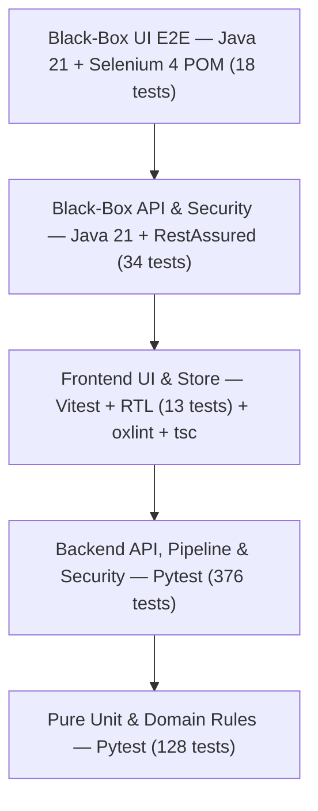

# SubBuild Studio 🎬

**SubBuild Studio** is a modular local web application for automated video subtitling, high-precision Speech-to-Text transcription with word-level timing, broadcast-grade subtitle refinement, and context-aware batch translation powered by multiple AI providers — **Google Gemini**, **OpenAI GPT**, **Anthropic Claude**, and **Ollama (Local / Cloud)** — with first-class RTL/Hebrew support.

---

## 🌟 Key Features

1. **Unified Zero-Copy Local Ingest, Stream Discovery & Embedded Subtitle Extraction:**
   - **Unified Ingest Dropzone & Path Input:** Drag & drop a video file directly onto the studio, click to browse, or paste a local path in one unified view.
   - **Recommended — Use the Desktop App Window (`SubBuild Studio.exe` / `run.bat`):** In the desktop window (Edge WebView2 / `pywebview`), dragging & dropping a video or clicking to browse resolves the file's **direct local path** on disk (`CoreWebView2File.Path` / native file dialog) without uploading or copying a single byte to temp, and preserves the video's folder for **Save next to video**.
   - Right-click the path field for a one-item **Paste** menu (also works in the desktop window, where it reads the clipboard through the app).
   - Discovers all video, audio, and embedded subtitle tracks via `ffprobe` and lets you select the exact audio or text-based dialogue subtitle stream to use.
   - **Use Embedded Subtitles Toggle (`use_embedded_subtitles`):** When the video has an embedded text-based dialogue track (e.g., SRT/ASS/WebVTT inside an MKV), SubBuild extracts it directly for instant, studio-accurate timing without waiting for full Whisper transcription — or you can switch it off to force fresh Whisper transcription from the audio.
   - **Supplement with Whisper (`supplement_with_whisper`):** Optionally run Whisper alongside embedded or synced subtitles (`pipeline/missing_speech.py`) to detect and recover spoken lines missing from the subtitle track (such as unsubtitled radio chatter, background remarks, or foreign phrases) without duplicating existing lines.
   - **Smart Genre Presets (`GenrePresets`):** One-click preset selector at the top of the configuration panel (`🎬 Drama & Cinema`, `🔬 Documentary, Reality & Science`, `🚁 Action, Military & Tactical`, `🕵️ Thriller, Horror & Crime`, `🚀 Sci-Fi, Fantasy & Anime`, `⚡ Fast & Clean / Sitcom`) that automatically configures all Whisper, audio sensitivity, OCR, and translation settings for that genre, with live active-preset detection and a `Custom` badge when tweaked manually.
   - **Browser fallback:** If opened in a regular external browser (`--browser`), where web security blocks local path resolution, dropped files automatically fall back to upload with progress reporting, de-duplication (same name + size is reused), and automatic cleanup when the project is deleted.

2. **Hardware-Accelerated Transcription & High Speech Sensitivity:**
   - Powered by `faster-whisper` (CTranslate2) with automatic hardware detection (`CUDA FP16` on NVIDIA GPUs or `CPU INT8`).
   - Batched GPU inference (`WHISPER_BATCH_SIZE`) with automatic fallback to sequential decoding if VRAM runs out; `large-v3-turbo` available.
   - The model stays loaded between jobs; jobs queue for the GPU instead of loading two models at once.
   - Silero VAD, `condition_on_previous_text=False` and loop detection against hallucinated repetitions.
   - **High Speech Sensitivity (`high_speech_sensitivity`):** Optional per-job toggle that relaxes VAD and decoding thresholds to catch quiet whispers, murmurs, and speech partially buried under loud music or sound effects.
   - Surround (5.1/7.1) tracks are downmixed with emphasis on the dialogue centre channel (boosting center speech while attenuating LFE/surround noise).
   - Cancel really stops Whisper mid-file.

3. **Broadcast-Grade Subtitle Refinement, Smart End-Credits Detection, Speaker Split & SDH Cleaning:**
   - Re-segments Whisper's output by sentence: lines Whisper cut mid-sentence are re-joined, dangling one-word fragments are merged, and sentences from different Whisper segments are never glued together (avoids mixing speakers).
   - **Smart End-Credits Detection & Post-Credits Scene Preservation (`skip_end_credits`, `pipeline/credits_detect.py`):** Automatically detects and skips end-credits rolls, cast/crew cards, and closing songs (including punctuated hip-hop/rap lyrics) in the tail of the video using container chapter markers (`ffprobe -show_chapters`), visual thumbnail analysis of dark scrolling credit screens (`thumbs.raw`), and text/dialogue clustering — while preserving mid-credits and post-credits dialogue scenes (e.g. Marvel stingers) and narrative stinger cards (`[THOR WILL RETURN]`, `[MEANWHILE...]`).
   - **Multi-Speaker Turn Splitting & SDH Cleanup (`utils/speaker_split.py`):** Automatically detects and formats multi-speaker dialogue turns with standard dialogue dashes (`- ...`), and offers a **Clean Hearing-Impaired (SDH) Tags (`remove_sdh_speakers`)** toggle per job in the post-video Setup screen (also controlled by **Genre Presets**) that strips speaker labels (`JOHN:`, `[MAN]`) and sound-effect cues (`(sighs)`, `[door slams]`) from spoken dialogue while preserving genuine `[ON_SCREEN]` titles.
   - Long sentences are split at clause boundaries/pauses, max 42 characters per line and 2 lines per subtitle.
   - Timing pass: no overlaps, ≥2-frame gaps, display time extended toward a target reading speed (`TARGET_CPS`), short gaps closed to avoid flicker.
   - Reading speed (CPS) badges, plus a categorized problem filter (`All problems`, `Untranslated / failed`, `Leftover English in translation`, `Fast reading speed / CPS`) and segment tag filter in the editor.

4. **Context-Aware Multi-Provider Subtitle Translation (Google Gemini, OpenAI, Anthropic, Ollama):**
   - Mix and match providers per stage (*Translation*, *Glossary pass*, *On-screen OCR/Vision*) or keep one provider across the whole pipeline (e.g., local Ollama for Translation + Gemini Flex / GPT-5 nano for frame OCR).
   - Default batch size of 120 lines for Gemini (`GEMINI_BATCH_SIZE=120`) and tuned batch sizing for OpenAI / Anthropic / Ollama (`~30–50`), paired with adaptive splitting and structured JSON schema validation (`core/provider_catalog.py`, `providers/llm/client.py`).
   - **Dedicated On-Screen Translation Pass:** `[ON_SCREEN]` cues (burned-in signs, location chyrons, HUD telemetry, text messages) are translated in a separate pass with a dedicated sign/title prompt from spoken dialogue (`DIALOGUE` / `COMMS` / `FOREIGN`), preventing sign text and overlapping dialogue from contaminating or overwriting each other during translation.
   - One glossary pass over the whole transcript (characters, gender, terminology) feeds translation, with per-batch dynamic glossary pruning (main cast + characters and terms appearing in the active window) so prompts stay compact without mutating the saved glossary.
   - **Metric System Conversion Toggle (`convert_to_metric`):** Optional per-job setting in the Setup screen (and Genre Presets) to automatically convert imperial measurements (miles, feet, inches, lbs, Fahrenheit, gallons, acres) into natural, idiomatic metric equivalents (km, m, kg, Celsius, liters, dunams) with natural rounding while preserving figurative idioms.
   - Missing lines are retried individually; anything that still fails is **flagged**, never silently left in English. "Retranslate failed" / "Retranslate all" (or a different target language) without re-transcribing.
   - Subtitles are saved as soon as they're refined and after every translated batch — nothing is lost if translation fails.

5. **Bidirectional RTL Punctuation Safety (Hebrew & Arabic):**
   - Text is stored clean; Unicode Right-to-Left Marks (`\u200f`) are added at export so `?`, `!` and dialogue hyphens land on the correct side in VLC, Plex and HTML5 players. SRT files are written with a UTF-8 BOM for player compatibility.

6. **📻 Tactical Comms & Radio Boost (optional, per job):**
   - Extracts audio through a speech-band filter chain (180Hz–3.8kHz, FFT denoise, compressor, `dynaudnorm`) so faint or distorted walkie-talkie traffic and whispers survive.
   - Whisper runs with a permissive VAD, relaxed `no_speech`/`log_prob` thresholds and a tactical vocabulary prompt (`initial_prompt` + `hotwords`).
   - Radio-procedure lines ("Copy that, over.", "Do you copy?", "…come in.") are tagged `COMMS` and translated with authentic IDF radio phrasing ("רות", "עבור").

7. **📺 On-Screen Text, Sensitivity Levels, GPU Frame Sampling & Live Positioning:**
   - Uses an embedded forced/"signs" text subtitle track when the file has one.
   - Otherwise samples video frames in the background while Whisper transcribes. Sampling is GPU-accelerated (`-hwaccel auto` via NVDEC/D3D11VA) and demuxes only keyframes (`-discard nokey`) on full episodes, completing 36-minute 1440p 60fps AV1/HEVC scans in ~29 seconds instead of 20+ minutes on CPU.
   - **3-Level On-Screen Sensitivity (`onscreen_sensitivity`):** Choose between **1 — Strict (Titles Only)** (major location/time cards, ~3s intervals, max 360 frames), **2 — Balanced** (narrative signs, chyrons, and important on-screen text, ~2s intervals, max 660 frames), or **3 — Broad / Maximum** (dense sampling every 1s up to 1,200 frames + scene cuts to catch brief text messages, handwritten notes, documents, and HUD details).
   - Repeated detections are merged into one `[bracketed]` `ON_SCREEN` subtitle with stable appearance/disappearance boundaries and woven into the timeline. Lone short words (HUD/radio callsigns like "EAGLE") are dropped, and signs returning within 3 minutes are not repeated.
   - **Speech Overlap & Comfortable Reading Time (`allow_onscreen_overlap`):** On-screen titles (chyrons, speaker roles/credentials) can appear concurrently with bottom dialogue lines (`allow_onscreen_overlap=True` by default) or be sequenced without overlap. On-screen cues enforce a minimum 3.0-second display duration (scaled up for longer text) so viewers can comfortably read both the sign and the dialogue.
   - **Live Screen Position Selector (`onscreen_position`):** Choose where on-screen translations appear (`Top Center \an8`, `Center \an5`, `Center Right \an6`, `Center Left \an4`, `Top Right \an9`, `Top Left \an7`) per job in Ingest (Setup screen) or **live inside the Studio editor toolbar** (`PATCH /api/jobs/{id}/settings`) without re-running the job. The HTML5 video player renders separate top/middle and bottom subtitle layers simultaneously, and exports serialize standard SubStation Alpha `{\anX}` tags in SRT and cue positioning in WebVTT.
   - **Speech in other languages** (e.g. Russian in an English episode): passages in another language are detected, sampled from the bottom third with GPU acceleration, and read from burned-in subtitles (or re-transcribed by Whisper).

8. **Interactive Studio Workspace, Virtualized Editor & Project Management:**
   - Split-screen workspace with synced HTML5 video player (HTTP Range seeking), dual-layer subtitle overlay (simultaneous dialogue + positioned on-screen cues), seek bar, and fullscreen.
   - **60fps Virtualized Subtitle Table:** Windowed table rendering keeps only the visible viewport rows (+ overscan buffer) mounted in the DOM, paired with deferred search filtering (`useDeferredValue`) and primitive playhead index subscriptions so 2,500+ line feature films scroll and edit with zero lag.
   - **Quick Jump & Fast Range Selection:** Jump directly to any line number (`#1850`) or timestamp (`1:15:00`) from the table toolbar, jump to the top/bottom of the list in one click, or select all rows from row `#X` to the end (or from the start to `#X`) via the row action button, `Alt+Click` on a checkbox, or the selection bar.
   - Keyboard: `Space` play/pause, `←/→` ±2s (`Shift` ±0.1s), `[` / `]` set the subtitle start/end to the playhead, `N` add a line at the playhead, `F` fullscreen, `Ctrl+Z` / `Ctrl+Y` undo / redo.
   - **Add, Delete & Bulk-Delete lines:** *Add line* above the table (or `N`) opens it at the playhead, the `+` under a row number right after that row. Select individual rows, Shift-click a range, expand selection to the end, or use the **Select All checkbox** in the table header to bulk re-translate or bulk delete (`DELETE /api/jobs/{id}/segments`) selected subtitle rows with automatic renumbering.
   - **Bulk Project Deletion & Clear All (Sidebar):** Select multiple projects in the sidebar or click **Clear All** to delete finished jobs, their cached audio/frames/logs, and their owned uploads in one action (`POST /api/jobs/bulk-delete`, `DELETE /api/jobs`).
   - **Filter by Tag & Categorized Problems:** Dedicated tag filter dropdown (`ON_SCREEN` 📺, `COMMS` 📻, `FOREIGN` 🌐, or any tagged cue) and categorized problem filter (`All problems`, `Untranslated / failed`, `Leftover English in translation`, `Fast reading speed / CPS` — also clickable directly from the bottom warning badge).
   - Inline editor with debounced auto-save, ±100ms nudges, and bulk Search & Replace (with Regex toggle).
   - **Undo / Redo & History panel (Photoshop-style):** every change — typing in a line, timing, Replace All, adding/deleting/moving lines, *Re-check timing*, re-translations — is a step. `Ctrl+Z` / `Ctrl+Y` (or `Ctrl+Shift+Z`, any keyboard layout) undo and redo; the **History** panel lists all steps with their time, highlights the current one and jumps to any of them. Steps after the current one stay (dimmed) until you make a new edit. Typing in one line counts as one step, and the history is saved with the project, so it survives a restart (the newest 100 steps are kept).
   - Export to `.srt` or `.vtt`, named for media servers (e.g. `Movie.he.srt`).
   - **Save next to video:** one click writes the translated `.srt` straight into the video's own folder (`Movie.he.srt` beside `Movie.mkv`), ready for Plex/Jellyfin/VLC. An existing file is only replaced after you confirm; not available for browser uploads, which have no folder of their own.

9. **⏱ Sync Existing Subtitles (+ Optional Whisper Supplement):**
   - Choose **Sync my subtitles** on the setup screen, pick the video and a subtitle file you already have (SRT, WebVTT or ASS, in any language and encoding: UTF-8/UTF-16/Windows-1255 Hebrew files are read correctly). The existing text is never changed, only the timing.
   - Matches speech rhythm (Silero VAD + Whisper word times), embedded/burned-in tracks, and AI translation anchors.
   - Optionally enable **Supplement missing speech with Whisper** and **On-screen OCR** during sync so any untranscribed spoken lines or burned-in signs missing from your subtitle file are automatically transcribed, translated, and merged into the synced timeline.

10. **💡 Cost-Saver Mode & Local AI Offloading (Optional Toggle):**
    - **One simple toggle** in Settings (`cost_saver_mode`, off by default to protect weak laptops).
    - **Local frame pre-filtering:** Pillow-based edge detection and 64-bit difference hashing (`dHash`) filter out blank/textless frames and merge consecutive identical title cards before calling Vision AI, saving ~75–80% of Vision image tokens.
    - **GPU VRAM unloading:** Unloads Faster-Whisper from GPU memory right after transcription completes so 8GB GPUs have free VRAM for local LLMs or system tasks.
    - **Zero-config local gender pre-tagging (Ollama):** Auto-detects local Ollama (e.g. `qwen2.5:7b`), pre-tags ambiguous pronoun lines (`you`, `I am`) with `[Speaker: M/F, To: M/F]` hints locally for Hebrew/Arabic translation, cutting cloud token overhead. Silently skips with zero delay if Ollama is not installed.
    - **One-click Ollama setup:** Settings screen includes live Ollama status, a link to the official Ollama download (the app never downloads and runs an installer itself), one-click daemon startup / model pull once Ollama is installed (`POST /api/settings/ollama/setup`), and instructions for advanced users.

11. **📊 Live & Post-Run Token & Local AI Savings Summary:**
    - Live monitoring bar in the studio and final run summary shows:
      - Breakdown of tokens and cost used per AI provider/model (specifying the exact provider/model and input/output/thinking counts).
      - Local AI queries sent to Ollama and model name.
      - Tokens and video frames saved locally by Cost-Saver pre-filtering.

12. **❓ Dedicated Help, User Guide & Q&A Screen:**
    - Dedicated **"Help & Q&A"** button in the sidebar bottom panel opens a comprehensive standalone guide.
    - 4-step quick-start workflow overview (Media Ingest, Configuration, Live Monitoring, Review & Export).
    - Interactive FAQ accordion covering Whisper model choices, Comms Boost, Cost-Saver Mode, Hebrew gender rules, multi-provider AI models (Gemini, OpenAI, Anthropic, Ollama) and Google Flex mode, timing fixes, and video player codec compatibility.

---

## ⚙️ Settings, Models & Pricing

Open **Settings** (bottom of the sidebar — its compact status badge tracks readiness across all 3 active pipeline steps at a glance). The screen uses a clean, single-page **Bento layout** designed to eliminate clutter and remove duplication with per-video job setup:

- **Compact Header & Appearance Bar** — interface language (Hebrew / English, with full RTL layout in Hebrew), Dark / Light theme, and *Back to studio* in one streamlined header row.
- **Multi-Provider AI Key Vault (`ApiKeySection`)** — auto-collapsed when keys are configured (plus first-run onboarding modal when no AI key exists yet). Tabbed management panel (`GET/POST /api/settings/keys`, `PUT/DELETE /api/settings/keys/{key_id}`, `POST /api/settings/providers/refresh`) supporting **Google Gemini**, **OpenAI**, **Anthropic Claude**, and **Ollama (Local / Cloud)** with multiple named keys per provider, default key selection, direct "Get API Key" links, masked secret previews (`AIza••••••••abcd`), and automatic live model discovery.
- **AI models per Pipeline Step (3-Column Stage Grid)** — *Translation*, *Glossary pass*, and *On-screen text (vision)* appear side-by-side on desktop (plus frame detail resolution inside Vision). Pick provider, optional key, model, thinking level (for Google Gemini), and Flex mode per step, saved to `storage/settings.json`.
  - **Zero Duplication with Setup (`PipelineConfig`):** Per-video formatting and content options (*Convert to metric*, *Remove SDH speaker names*, *Smart end-credits filter*, and default *On-screen OCR text position*) live exclusively in the post-video **Setup** screen (where **Genre Presets** also configure them per movie/episode) rather than duplicating controls in Settings.
  - **Strict live & task filtering:** Each dropdown displays only verified models returned by your configured key(s) that are actually capable of that pipeline step (e.g., retired Gemini 2.x/image/omni/latest aliases, OpenAI `-pro`/`-codex`/`search-api` and redundant dated snapshots, diffusion models, and sub-7B local models are excluded from translation). Local Ollama models query `/api/show` to discover native `vision` capability and parameter sizes.
  - **Best-Value (Cost / Quality) Auto-Selector:** One-click optimizer button (*Auto-select best value (Cost / Quality)*) inspects all configured keys across all providers, compares episode costs including Google **Flex (`-50%`)**, and assigns the lowest-cost recommended model per stage (enabling Flex automatically when Google Flex wins). Includes an optional GPU/VRAM-aware **"Include free Local AI"** checkbox that only selects recommended local models (`>= 6.5B`) fitting your detected CUDA VRAM (`8GB -> <=12.5B`, `12GB -> <=16B`, etc.) and explains any local models skipped as too heavy.
  - **Episode & movie cost benchmarks:** Each model card shows estimated ~45m episode and ~120m movie costs before running (local Ollama shows `$0.00`).
  - **Flex mode** (Google Gemini steps): sends requests with `service_tier="flex"` at 50% of the Standard price when Google has spare capacity, with automatic fallback to Standard on repeated busy errors (`429`/`503`).
  - **Test models** sends a tiny request to each configured step (including an image for Vision, over Flex when Flex is on) to confirm your active key/daemon can run it (`POST /api/settings/check`).
- **Missed-speech recovery** (on by default, `WHISPER_GAP_RECOVERY=false` to disable): the voice detector (Silero VAD) misses speech under gunfire, engines, music and radio filtering, so Whisper never hears it. After transcription, Whisper re-listens *without* VAD to every stretch no subtitle covers and keeps only lines that pass strict hallucination checks; each kept/rejected line is listed in the project log. Shouted commands ("Fire!", "Go, go, go!", "Cease fire!") are judged by their own words rather than the noisy window's confidence, and repeats of a neighbouring command are kept.
- **Subtitle start alignment** (on by default, `WHISPER_SNAP_STARTS=false` to disable): Whisper's word timestamps ignore silence, so a word that follows a pause is stamped right after the previous word and the subtitle can appear a second or two before anyone speaks. After transcription, Silero VAD finds where speech really begins and any word that spans a silent gap (0.4s or longer) is moved to just before the speech that follows it (starts are only ever moved later, and speech the detector misses is left as Whisper timed it). The job log shows how many word starts were moved.
- **Re-check timing (finished jobs)**: the *Re-check timing* button above the table re-extracts the audio, runs voice-activity detection over the whole video and moves every subtitle that starts in a silence shortly before speech to just before that speech (text and on-screen cues are never touched; there is an *Undo* right after). Results are cached in `storage/regions`. The API is `POST /api/jobs/{id}/retime`.
- **Drag to reorder**: drag a row by the handle in the `#` column to another row. The text moves, the time slots stay, and only the rows between the two positions are re-checked against the audio of that section (a subtitle sitting in silence is moved to the speech that follows it). Disabled while a search or the problems filter is active, and while the job runs. The API is `POST /api/jobs/{id}/segments/move`.
- **Click a row to play**: clicking a subtitle row jumps the video to 1.5 seconds before that subtitle and starts playing, so you hear the lead-in (never earlier than the start of the video).
- **Gender and who is being spoken to**: subtitles carry no speaker names, so "you" can come out in the wrong gender. Tick the checkbox next to a few rows (Shift-click for a range) and use *Speaking to a woman / man / group*, or *Re-translate with a note...* to also set the speaker's gender and add free text (optionally remembered in the job's context notes). Only the selected rows are translated again, with the note as a top-priority instruction (`POST /api/jobs/{id}/translate` with `segment_ids`, `speaker_gender`, `addressee_gender`, `hint`).
- **Characters & terms editor**: the *Characters & terms* button opens the glossary the translator was given (gender, name spelling, terms, tone). Fix it, save, and optionally re-translate everything. The API is `PUT /api/jobs/{id}/glossary`.
- **Series glossary profiles**: give a show a name (in the setup screen, or in the *Characters & terms* window) and its characters, genders, name spellings and terms are saved under `storage/glossaries/`. Later episodes that use the same name start from that list (it is treated as authoritative), the glossary pass only adds characters and terms that are new, and the profile grows with every episode. The API is `GET /api/glossary-profiles`.
- **Check quality**: a button above the table scans the translation without calling any model and lists untranslated Latin words, names/terms that differ from the glossary, "את/אתה" pronoun and verb mismatches, and missing translations. Click an item to jump to the row, or select all the flagged rows and re-translate them. The API is `GET /api/jobs/{id}/qa`.
- **Detect from video**: in the "re-translate with note" window (`RowTranslateDialog`), only available translation-capable models from your active keys are shown (with provider labels, and Thinking levels shown for Google Gemini models); clicking *Detect from video* sends 2-3 frames around the selected rows plus their dialogue to the Vision AI provider and fills in the speaker and addressee gender. The API is `POST /api/jobs/{id}/detect-speakers`.
- **Storage, Diagnostics & Feedback (2-Column Bento Row):** **Storage and cleanup** (`GET /api/storage`, `POST /api/storage/clean`) shows storage categories in a compact 2×3 card grid (protecting source folders, running jobs, and `server.log`), paired side-by-side with **Diagnostics** (*Download server log* `storage/logs/server.log`) and bug/feature links. Every project also keeps its own detailed log (`storage/logs/jobs/<job>.log`) accessible via the **Log** button in the studio.
  - Flex: after 2 requests in a row fall back to Standard, the rest of the job uses Standard for that model.
- **Cost-Saver Mode & Cost Estimator (2-Column Bento Row):**
  - **Cost Estimator (collapsible):** per-step requests, tokens and dollars for a video of any length, recalculated live as you change models (before saving), paired beside Cost-Saver Mode. The setup screen also shows the estimate for the loaded file.
  - **Cost-Saver Mode & Ollama Local AI** (default off, with collapsible setup guide & CLI instructions):
    - Pre-filters sampled frames locally using Pillow edge detection and 64-bit dHash perceptual hashing, filtering out ~75–80% of textless frames before calling cloud/local Vision.
    - Automatically unloads Faster-Whisper from GPU memory right after transcription to free VRAM for local models.
    - Automatically pre-tags ambiguous pronouns (`you`, `I am`) using a local Ollama model (e.g. `qwen2.5:7b`), eliminating cloud token overhead for gender disambiguation.
    - Features live Ollama service & model status, a download link to the official installer, a one-click button that starts Ollama and pulls the model (`POST /api/settings/ollama/setup`), and a collapsible details drawer with manual CLI links for advanced users.
- **Live & Post-Run Token & Local AI Savings Breakdown**:
  - Live studio monitor bar and final run summary display per-model token usage (input, output, thinking) across active providers, Ollama local queries handled, and total frames/tokens saved by local pre-filtering.

Pricing covers Google Gemini (paid tier + dated promotions in `backend/app/core/model_catalog.py`), OpenAI (including GPT-5.4 / GPT-6 tiers & image billing rules), Anthropic Claude, and `$0.00` local Ollama in `backend/app/core/provider_catalog.py`. Every job records exact tokens and cost per step in `Job.usage_json`.

---

## 🏗️ Repository Architecture

Pipeline per job: **Probe → Audio → Transcribe → On-screen text** *(optional)* **→ Refine → Translate**, with live progress and segments pushed over a WebSocket (`/ws/jobs/{job_id}`).

```text
SubBuild Studio/
├── SPEC.md                     # Architecture, tech stack and design decisions
├── README.md                   # Setup and usage guide
├── install.bat / run.bat       # One-click Windows installer & launcher
├── install.sh / run.sh         # One-click Linux & macOS installer & launcher
├── install.command / run.command # Double-clickable macOS Finder wrappers
├── build_exe.bat               # Builds the standalone desktop app (dist\SubBuild Studio\)
├── packaging/                  # Tray launcher, PyInstaller spec, icon, FFmpeg download script
├── backend/
│   ├── .env.example            # Configuration template (copy to .env)
│   ├── requirements.txt        # Python dependencies (incl. CUDA cuBLAS/cuDNN wheels)
│   ├── app/
│   │   ├── main.py             # FastAPI app: CORS, trusted hosts, CSRF guard, routers, startup discovery, WebSocket
│   │   ├── api/                # Routes: system, media, jobs, export, settings (+ key vault), glossary profiles, storage
│   │   ├── core/               # Config, SQLite DB, hardware/VRAM detection, WS manager, model_catalog,
│   │   │                       #   provider_keys, provider_catalog, model_discovery, user_settings, glossary_profiles,
│   │   │                       #   job_logging, housekeeping, storage_cleanup, ollama_setup
│   │   ├── models/             # SQLModel tables & Pydantic schemas
│   │   ├── pipeline/
│   │   │   ├── orchestrator.py # Runs the stages: GPU queue, cancel, save-as-you-go, recovery after restart
│   │   │   ├── job_report.py   # Per-job log: settings at the start, result, usage and cost at the end
│   │   │   ├── stages/         # probe, audio, transcribe, ocr (on-screen text), refine, translate, sync
│   │   │   ├── segmentation.py, timeline_merge.py    # Refine: Whisper words -> subtitles; COMMS/on-screen/foreign merge
│   │   │   ├── embedded_tracks.py   # Forced / dialogue subtitle tracks inside the video
│   │   │   ├── frame_sampling.py, onscreen_vision.py, onscreen_merge.py   # On-screen text: frames -> Vision AI -> segments
│   │   │   ├── sync_align.py   # Sync: offset / frame rate / cuts (correlation + dynamic programming)
│   │   │   ├── sync_text.py    # Sync: line-to-speech anchors (local word matching, AI)
│   │   │   ├── sync_burned.py  # Sync: burned-in subtitle detection (local frame analysis)
│   │   │   ├── gap_recovery.py # Missed-speech recovery (Whisper without VAD over uncovered audio)
│   │   │   ├── missing_speech.py      # Supplement embedded/synced subtitles with Whisper speech detection
│   │   │   ├── word_snap.py    # Subtitle start alignment
│   │   │   ├── onscreen_prefilter.py  # Local frame edge & dHash pre-filter (with steady-state retention)
│   │   │   ├── credits_detect.py      # Smart end-credits detection & mid/post-credits scene preservation
│   │   │   ├── gender_pretag.py       # Local Ollama pre-tagging
│   │   │   ├── glossary_pruner.py     # Dynamic glossary pruning per batch
│   │   │   ├── speech_regions.py, retime.py   # Speech maps, "Re-check timing" and drag-to-reorder
│   │   │   ├── foreign_speech.py              # Passages in other languages
│   │   │   ├── speaker_detect.py, qa.py       # Gender detection from frames, quality check
│   │   │   └── context.py                     # Job context passed between stages
│   │   ├── providers/          # faster-whisper transcription; llm/client.py (Gemini, OpenAI, Anthropic, Ollama); Flex wrapper
│   │   └── utils/              # SRT/VTT formatter, subtitle file parser, RTL fixer, speaker split/SDH cleaner, languages, text rules
│   ├── pytest.ini              # Pytest markers (unit, api, pipeline, ffmpeg, security, smoke, regression)
│   └── tests/                  # Layered pytest suites (unit/, api/, pipeline/, security/, fixtures/)
├── frontend/                   # React 19 + TypeScript + Vite 8 + Tailwind 4 + Zustand
│   ├── vite.config.ts          # Build & dev proxy to the backend
│   └── src/
│       ├── components/         # ingest/ (incl. GenrePresets), monitor/, studio/ (table/ = subtitle table hooks & toolbar), settings/ (ApiKeySection, SettingsScreen, labels), layout/
│       ├── store/              # Zustand stores (jobs + WebSocket listener, settings, UI)
│       ├── services/api.ts     # Typed REST client
│       ├── hooks/              # Cost estimate
│       ├── i18n/               # English & Hebrew UI strings
│       ├── types/              # TypeScript data contracts
│       └── __tests__/          # Vitest + React Testing Library component/store tests
├── qa-automation-java/         # Java 21 + JUnit 5 + Selenium 4 POM + RestAssured black-box E2E & API suite
├── Jenkinsfile                 # Parameterized Jenkins CI/CD pipeline (Pytest + Frontend Build + Java E2E/Regression)
├── docs/
│   └── QA_TEST_PLAN.md         # Multi-layer QA architecture, test pyramid & execution guide
└── storage/                    # Created at runtime, git-ignored
    ├── subbuild.db             # Projects and subtitles (SQLite)
    ├── settings.json           # Choices from the Settings screen
    ├── provider_keys.json      # Saved multi-provider API keys (masked in API responses)
    ├── uploads/                # Browser-uploaded video copies
    ├── audio/, frames/         # Temporary audio and sampled frames
    ├── exports/                # Exported subtitle files
    ├── regions/                # Speech-map cache for "Re-check timing"
    ├── glossaries/             # Series glossary profiles
    └── logs/                   # server.log + jobs/<job>.log
```

### API at a glance

Interactive docs are at `http://localhost:8000/docs` while the server runs.

| Area | Endpoints |
|---|---|
| System | `GET /api/system/info` (hardware/VRAM, provider summaries, models), `GET /api/system/log` (server log) |
| Media | `POST /api/media/probe-path`, `POST /api/media/upload`, `GET /api/media/upload/existing`, `GET /api/media/stream/{job_id}` (Range), `POST /api/media/parse-subtitles` (read a subtitle file to sync) |
| Jobs | `POST/GET /api/jobs` (with `sync_cues` = a sync job), `GET/DELETE /api/jobs/{id}`, `DELETE /api/jobs` (clear all), `POST /api/jobs/bulk-delete`, `PATCH /api/jobs/{id}/settings` (live onscreen position), `POST /api/jobs/{id}/cancel`, `POST /api/jobs/{id}/translate` |
| Editing | `POST /api/jobs/{id}/segments` (add a line), `DELETE /api/jobs/{id}/segments/{segment_id}` (delete a line), `DELETE /api/jobs/{id}/segments` (bulk delete lines), `PATCH /api/jobs/{id}/segments/{segment_id}`, `PATCH /api/jobs/{id}/segments` (bulk), `POST /api/jobs/{id}/segments/move`, `POST /api/jobs/{id}/retime` |
| History | `GET /api/jobs/{id}/history`, `POST /api/jobs/{id}/history/undo`, `POST /api/jobs/{id}/history/redo`, `POST /api/jobs/{id}/history/{entry_id}/restore` |
| Translation tools | `PUT /api/jobs/{id}/glossary`, `POST /api/jobs/{id}/detect-speakers`, `GET /api/jobs/{id}/qa`, `GET /api/glossary-profiles` |
| Export | `GET /api/jobs/{id}/export/srt`, `GET /api/jobs/{id}/export/vtt`, `GET /api/jobs/{id}/export/log`, `POST /api/jobs/{id}/export/save-next-to-video` |
| Settings | `GET/PUT /api/settings`, `GET/PUT /api/settings/api-key`, `GET/POST /api/settings/keys`, `PUT/DELETE /api/settings/keys/{key_id}`, `POST /api/settings/providers/refresh`, `POST /api/settings/estimate`, `POST /api/settings/check`, `GET /api/settings/ollama/status`, `POST /api/settings/ollama/setup` |
| Storage | `GET /api/storage`, `POST /api/storage/clean` |
| Live | `WS /ws/jobs/{job_id}` |

---

## 🚀 Quickstart Guide

### 1. Prerequisites
- **Python 3.11+** (`run.bat` uses 3.12)
- **Node.js 20.19+ or 22.12+** & npm (required by Vite 8)
- **FFmpeg & FFprobe** installed and accessible on PATH
- **Optional:** an NVIDIA GPU for fast transcription. The CUDA cuBLAS/cuDNN runtime comes from `requirements.txt`, so no separate CUDA install is needed; without a GPU Whisper runs on the CPU (INT8).

### 2. Backend Setup
```bash
# Navigate to backend directory
cd backend

# Create virtual environment (using uv or python -m venv)
uv venv --python 3.12 .venv
# On Windows:
.venv\Scripts\activate

# Install dependencies
uv pip install -r requirements.txt

# Configure environment variables
cp .env.example .env
```

Edit `backend/.env` (optional if managing keys in the Settings UI) to configure defaults or a Google Gemini API key:
```env
GEMINI_API_KEY=your_gemini_api_key_here
WHISPER_DEFAULT_MODEL=medium
WHISPER_DEVICE=auto
```

AI provider keys (Google Gemini, OpenAI, Anthropic, Ollama), per-stage models, thinking levels (Translation, Glossary, and Vision), and Best-Value auto-selection are configured in the app's **Settings** screen (saved to `storage/provider_keys.json` and `storage/settings.json`).

Optional settings (defaults shown):

| Setting | Default | What it does |
|---|---|---|
| `WHISPER_DEVICE` / `WHISPER_COMPUTE_TYPE` | `auto` / `auto` | `cuda` or `cpu`; `float16` or `int8`. `auto` picks CUDA FP16 when a GPU is found, otherwise CPU INT8. |
| `WHISPER_BATCH_SIZE` | `8` | Batched GPU inference. Lower if you run out of VRAM; `0` = sequential. |
| `WHISPER_GAP_RECOVERY` | `true` | Missed-speech recovery (see Settings above). |
| `WHISPER_SNAP_STARTS` | `true` | Subtitle start alignment (see Settings above). |
| `MAX_CONCURRENT_TRANSCRIPTIONS` | `1` | Jobs allowed on the GPU at once (others wait as *Queued*). |
| `GEMINI_BATCH_SIZE` | `120` | Subtitle lines per translation request. |
| `GEMINI_GLOSSARY_PASS` | `true` | Build a character/terminology glossary before translating. |
| `COST_SAVER_MODE` | `false` | Enable local frame pre-filtering, Whisper VRAM unloading, and local Ollama pre-tagging. |
| `ALLOW_ONSCREEN_OVERLAP` | `true` | Allow on-screen OCR titles to display concurrently with dialogue subtitles. |
| `ONSCREEN_POSITION` | `top_center` | Default screen position for on-screen OCR text (`top_center`, `middle_center`, `middle_right`, `middle_left`, `top_right`, `top_left`). |
| `CONVERT_TO_METRIC` | `false` | Convert non-metric units (miles, feet, pounds, Fahrenheit, etc.) to metric equivalents during translation. |
| `REMOVE_SDH_SPEAKERS` | `false` | Strip hearing-impaired speaker labels (`JOHN:`) and sound cues (`[sighs]`) from dialogue while keeping `[ON_SCREEN]` titles. |
| `SKIP_END_CREDITS` | `true` | Automatically skip end-credits rolls and closing songs while preserving mid-credits and post-credits scenes. |
| `GEMINI_VISION_MODEL` | `gemini-3.5-flash-lite` | Initial model that reads on-screen text from frames. |
| `ONSCREEN_FRAME_INTERVAL` / `ONSCREEN_MAX_FRAMES` | `2.0` / `660` | Frame sampling interval (s) and max frames sent to Vision AI (scaled per sensitivity level 1–3). Frame extraction uses GPU acceleration (`-hwaccel auto`). |
| `ONSCREEN_BATCH_SIZE` | `12` | Frames per Vision AI request. |
| `MAX_CHARS_PER_LINE` | `42` | Line length limit for refinement and export. |
| `TARGET_CPS` / `MAX_CPS_WARNING` | `17` / `20` | Reading speed the timing pass aims for / when the editor flags a line. |
| `MIN_SUBTITLE_DURATION` / `MAX_SUBTITLE_DURATION` | `1.0` / `7.0` | Display time limits (seconds). |
| `UPLOAD_RETENTION_HOURS` | `24` | Unused browser uploads older than this are removed at startup. |
| `STORAGE_DIR` / `DATABASE_URL` | `./storage` / `sqlite:///./storage/subbuild.db` | Where data and the database live. |
| `HOST` / `PORT` | `127.0.0.1` / `8000` | Server address. Keep `127.0.0.1` unless you really want LAN access: the API can read any file path on this PC. |
| `SYNC_DETECT_BURNED_IN` / `SYNC_BURNED_IN_FPS` | `true` / `5` | *Sync my subtitles*: look for subtitles burned into the picture (local), and how many frames per second to check. |
| `ALLOWED_HOSTS` | `["localhost","127.0.0.1","[::1]"]` | Host names the server answers to (blocks DNS-rebinding attacks). Add your PC's LAN name/IP if you set `HOST=0.0.0.0`. |
| `CORS_ORIGINS` | `["http://localhost:8000", "http://127.0.0.1:8000"]` | Browser origins allowed to use the API. State-changing requests and WebSockets from any other website are rejected (CSRF guard); the studio's own page is always allowed. |
| `SUBBUILD_DEV` | `false` | Development only: also trust the Vite dev server (`http://localhost:5173`, `http://127.0.0.1:5173`). Off by default, so another program on port 5173 can't drive the installed app. |
| `SUBBUILD_TOKEN` | random per launch | Session token. Every `/api` and `/ws` request needs it (as an HttpOnly cookie set by opening `/?token=<token>` once, or an `X-SubBuild-Token` header), so other programs, other Windows accounts and the LAN can't use the API. The desktop app and `run.bat` / `run.sh` set it for you; set it yourself only for development. |

API keys saved in the Settings Key Vault (or the first-run dialog) are persisted to `storage/provider_keys.json` (and legacy Google keys via `/api/settings/api-key` also write to `.env`). A key typed on the Ingest screen for a single job is used in memory for that run only and is never written to disk.

### 3. Frontend Setup
```bash
# Navigate to frontend directory
cd frontend

# Install dependencies
npm install

# Build the frontend production bundle
npm run build
```

---

## 🏃 Running the Application

> 💡 **Recommendation for Best Experience:** Always prefer running SubBuild Studio in its **native desktop window** (`SubBuild Studio.exe`, `run.bat`, or `./run.sh --window`) rather than a regular web browser. In the desktop window, dragging & dropping a video or clicking to browse reads the file's **direct local path** in place (0 seconds wait, 0 GB copied to temp/uploads, and full support for *Save next to video*), clipboard paste works without browser permission prompts, and video fullscreen controls the window directly.

### Option A1: One-click (Windows — Recommended)
Run `install.bat` (first-time setup) or simply double-click `run.bat`. During installation, you will be prompted to create a desktop shortcut with the official SubBuild Studio icon. The launcher creates the virtual environment if needed, rebuilds the frontend whenever its sources changed, and opens the studio in its own app window (Edge WebView2, no browser, no console) with a tray icon. Your API key and projects stay in `backend\.env` and `backend\storage`. Run `run.bat --browser` to get the console server and open the studio in your browser.

### Option A2: One-click (Linux & macOS)
Run the installer once, then start the studio with `./run.sh` (or on macOS, double-click `install.command` and `run.command` directly in Finder). During installation, the installer offers to add SubBuild Studio directly to your Applications menu (Launchpad on macOS / application launcher on Linux) with the official application icon:
```bash
# First-time setup (checks/installs prerequisites, creates backend/.venv, .env, builds frontend, and installs app shortcut):
./install.sh

# Start SubBuild Studio (auto-rebuilds frontend if modified and opens http://localhost:8000):
./run.sh
```
Pass `./install.sh --desktop` and `./run.sh --window` if you want the native `pywebview` desktop window instead of opening in the browser. Pass `./run.sh --no-browser` to start the server without opening a browser tab. To manually add or remove desktop shortcuts anytime, run `python packaging/create_shortcut.py` (or `--remove`).

### Option B: Standalone Production Mode (Single Command)
Run the backend server, which automatically serves the compiled frontend on port 8000:
```bash
# From workspace root or backend directory:
backend\.venv\Scripts\python.exe -m uvicorn app.main:app --app-dir backend --host 127.0.0.1 --port 8000
```
Use `--host 0.0.0.0` only for LAN access, together with `ALLOWED_HOSTS` (see the table above).
The server prints the link to open, **`http://localhost:8000/?token=…`**: the token is new on every start, and the page refuses to load without it (see `SUBBUILD_TOKEN` above).

### Option C: Development Mode (Hot Reloading)
**Terminal 1 — Backend:**
```bash
cd backend
.venv\Scripts\python.exe -m uvicorn app.main:app --reload --port 8000
```

**Terminal 2 — Frontend:**
```bash
cd frontend
npm run dev
```
With `--reload` the token would change on every reload, so give the backend a fixed one for development (PowerShell: `$env:SUBBUILD_TOKEN = "dev-token"`, bash: `export SUBBUILD_TOKEN=dev-token`) before starting it.
Also turn on dev mode so the backend trusts the Vite dev server's origin (PowerShell: `$env:SUBBUILD_DEV = "1"`, bash: `export SUBBUILD_DEV=1`); without it every change made from `:5173` is refused with 403.
Then open **`http://localhost:5173/api/session?token=dev-token`** once: it signs the browser in and lands on the studio (API requests & WebSockets proxy to `:8000`).

---

## 📦 Desktop App (Standalone EXE)

`build_exe.bat` turns the project into a standalone Windows program: a folder with **`SubBuild Studio.exe`** that includes Python, every library, the built frontend, FFmpeg and the NVIDIA CUDA runtime. The target PC needs no Python, Node or FFmpeg (only an NVIDIA driver for GPU transcription). The studio opens in **its own window** (pywebview on Microsoft Edge WebView2, which comes with Windows 10/11).

### Build
Requires the same tools as the Quickstart (Python or `uv`, Node.js). Double-click **`build_exe.bat`**. It:
1. installs the backend and build dependencies (`packaging/requirements-build.txt`: PyInstaller, pystray, Pillow, pywebview) into `backend\.venv`;
2. builds the frontend;
3. downloads a static FFmpeg build into `packaging\ffmpeg` (once; put your own `ffmpeg.exe` + `ffprobe.exe` there to skip it);
4. packages everything with PyInstaller (`packaging/subbuild.spec`) into **`dist\SubBuild Studio\`**;
5. copies `backend\.env` (your API key) to the app's data folder if that folder has none yet.

The output is about 2-3 GB, mostly the NVIDIA libraries. Copy or move the **whole** `dist\SubBuild Studio` folder; the exe needs the `_internal` folder next to it.

### Using it
- Run `SubBuild Studio.exe`: a SubBuild Studio window opens right away (with a short loading screen while the server starts) and an icon appears in the system tray. Running the exe again while it's open brings the existing window to the front.
- **The window** remembers its size. Exports ask where to save the file (*Save as*, starting in Downloads), and the video player's fullscreen makes the whole window fullscreen. Closing the window quits the app; if a project is still running it asks first: *Yes* quits (the project can be resumed later), *No* keeps working in the background with only the tray icon, *Cancel* goes back.
- **Tray menu** (right-click): *Open SubBuild Studio* (or just click the icon), *Open in browser*, *Open data folder*, *Edit settings (.env)*, *Server log*, *Restart server* (after editing `.env`) and *Quit*. Quit and Restart ask first if a project is still running.
- **Browser instead of a window:** start the exe with `--browser` (or set the environment variable `SUBBUILD_UI=browser`). If WebView2 is missing, the studio opens in the browser automatically (the reason is written to `launcher.log`); WebView2 can be installed from Microsoft (*Evergreen Runtime*).
- **Data folder:** the `.env`, projects database, settings, logs, the window's size and the studio's own preferences (`webview\`) live in `%LOCALAPPDATA%\SubBuild Studio`, not in the program folder, so rebuilding or replacing the program never touches them. To keep everything next to the exe instead (portable mode), create an empty `data` folder beside `SubBuild Studio.exe`; the `SUBBUILD_HOME` environment variable overrides both.
- **Upgrading from SubForge Studio:** the app was renamed. On first start it adopts the old data automatically: the `%LOCALAPPDATA%\SubForge Studio` folder is renamed to `SubBuild Studio`, `storage/subforge.db` becomes `subbuild.db`, the old `SUBFORGE_HOME` / `SUBFORGE_UI` variables still work, and the browser-stored preferences (language, theme, last pipeline settings) are carried over.
- Startup errors are shown in a message box. Details are in `launcher.log` and `storage\logs\server.log` in the data folder.
- Whisper models are downloaded on first use to the usual Hugging Face cache in your user profile, shared with the developer setup.
- The launcher also runs from source, without building: `backend\.venv\Scripts\python.exe packaging\launcher.py` (`--browser` for browser mode, `--no-tray` to run in the console, `--no-browser` to skip opening the browser in browser mode).

To change the icon, edit and run `packaging/make_icon.py` (it writes `packaging/icon.ico`).

---

## 🧪 QA Architecture & Running Tests

SubBuild Studio uses a **Multi-Layer Hybrid Test Pyramid** combining fast in-process Python/React tests with an external black-box Java automation framework. See **[docs/QA_TEST_PLAN.md](docs/QA_TEST_PLAN.md)** for the full architecture, risk matrix, and reporting guide.



### 1. Backend Pytest Suite (`backend/tests/`, 504 tests)
Tests are organized into explicit architectural layers with shared builders/fakes (`tests/fixtures/`) and registered markers in `backend/pytest.ini`:

```powershell
cd backend

# Run the full suite (504 tests)
.\.venv\Scripts\python.exe -m pytest -q

# Run by architectural layer or execution tag
.\.venv\Scripts\python.exe -m pytest -m unit -q        # 128 pure unit tests (no DB / no FFmpeg)
.\.venv\Scripts\python.exe -m pytest -m api -q         # 140 FastAPI + SQLite integration tests
.\.venv\Scripts\python.exe -m pytest -m pipeline -q    # 170 pipeline, AI provider fake & FFmpeg tests
.\.venv\Scripts\python.exe -m pytest -m security -q    # 66 auth, CSRF, headers, FFmpeg SSRF & upload tests
.\.venv\Scripts\python.exe -m pytest -m smoke -q       # 53 critical-path smoke tests
```

- **`tests/unit/`**: RTL BiDi wrapping, SRT/VTT timecode & formatting, segmentation/orphan-word healing, smart end-credits detection, speaker turn splitting & SDH cleanup, missing speech supplementation, QA rules, DB migration, and desktop launcher/shortcut logic.
- **`tests/api/`**: System info, multi-provider key vault & live discovery (`test_multi_provider_ai.py`), job persistence & slim listings, live WebSocket segment streaming, segment CRUD, undo/redo edit history, upload SHA-256 deduplication & Range parsing, row-scoped retranslation, glossary profiles, speaker detection, retime/reorder, settings/pricing, save-next-to-video, and storage cleanup.
- **`tests/pipeline/`**: End-to-end pipeline on generated FFmpeg clips, Whisper threading/OOM fallback/cancellation, Gemini/LLM batching/retries/Flex tier fallback, FinOps dHash pre-filtering & Ollama local pre-tagging, OCR & tactical comms boost, foreign speech, sync alignment/burned-in detection, gap recovery, word snapping, video embedding, and per-job logging.
- **`tests/security/`**: Per-launch session token (`X-SubBuild-Token` & HttpOnly cookie) and UNC path refusal, CSRF Origin/Fetch-Metadata & Host validation, anti-framing/CSP security headers, FFmpeg `-protocol_whitelist file` & AST audit, and `Content-Length` upload limits.

### 2. Frontend Checks & Tests (`frontend/`, 13 tests)
```powershell
cd frontend
npm run lint    # oxlint
npm test        # Vitest + React Testing Library (13 tests)
npm run build   # tsc -b + vitest run + vite build
```

### 3. Java Black-Box E2E & API Suite (`qa-automation-java/`, 52 tests)
Built with **Maven + Java 21 + JUnit 5 + Selenium WebDriver 4 (POM) + RestAssured + ExtentReports**. Starts an isolated temporary backend server automatically (never touching `backend/storage` or `backend/.env`), seeds data via RestAssured for fast UI tests, captures screenshots on failure, and writes an interactive HTML report to `qa-automation-java/target/reports/subbuild-qa-report.html`.

```powershell
cd qa-automation-java

# Full regression suite (52 tests: 34 API/Security + 18 Selenium UI, headless Chrome)
mvn clean test -Pregression

# Fast critical-path smoke suite (9 tests)
mvn test -Psmoke

# Direct JUnit 5 @Tag filtering also works
mvn test -Dgroups=regression   # 52 regression tests (includes the 9 smoke tests)
mvn test -Dgroups=smoke        # 9 critical-path smoke tests

# Optional browser / driver / headless overrides
mvn test -Dsubbuild.browser=edge -Dsubbuild.headless=false
mvn test -Pregression "-Dsubbuild.headless=true"
```

### 4. CI/CD Pipeline (`Jenkinsfile` on Raspberry Pi 4 ARM64 & GitHub Actions)
- **Branch flow (`staging` → `main`):** feature/fix branches are merged into **`staging`** first; every push there runs the full automation (GitHub Actions + Jenkins: pytest, frontend checks, Java RestAssured/Selenium). Only a green `staging` is merged into `main` (open the PR `staging` → `main`).
- **Self-Hosted Jenkins CI (Raspberry Pi 4 8GB, Linux `aarch64`):** Configured via [`Jenkinsfile`](Jenkinsfile) and triggered automatically on pushes to `staging` and `main` via **GitHub Webhook** (plus manual parameterized runs with `JAVA_PROFILE=regression|smoke`, `RUN_BACKEND_PYTEST`, and `RUN_FRONTEND_CHECKS`).
  1. **Preflight Check:** Verifies `python3`, `node`, `npm`, `java`, `mvn`, `ffmpeg`, and `chromium`/`chromedriver`.
  2. **Backend Pytest (`504` tests):** Provisions `backend/.venv` (filtering out `nvidia-*` CUDA packages, cached by `requirements.txt` SHA-256) and emits JUnit XML.
  3. **Frontend Checks & Build (`13` Vitest + Vite `dist`):** Runs `npm ci`, `oxlint`, `tsc -b`, `vitest run`, and `vite build` so `backend/app/main.py` serves `frontend/dist` for Selenium tests.
  4. **Java Black-Box QA (`52` regression / `9` smoke):** Executes `mvn -B clean test -P"${JAVA_PROFILE}" -Dsubbuild.headless=true -Dsubbuild.timeoutSeconds=30`, then publishes unified JUnit results and archives `ExtentReports` HTML + failure screenshots.
- **Cross-Platform Driver & Headless Resolution (`TestConfig` + `DriverFactory`):** Auto-enables `--headless=new` in `CI`/`JENKINS_URL`/`GITHUB_ACTIONS` or display-less Linux environments; preserves Selenium Manager on Windows and GitHub Actions (`ubuntu-latest` `x86_64`), and automatically falls back to OS-packaged `/usr/bin/chromium` + `/usr/bin/chromedriver` on Linux ARM64 (`aarch64`).
- **GitHub Actions ([`.github/workflows/tests.yml`](.github/workflows/tests.yml)):** Runs backend `pytest` + `pip-audit` and frontend `npm audit` + `oxlint` + `vitest` + `vite build` on `ubuntu-latest` (`main`, PRs, and weekly schedule).
