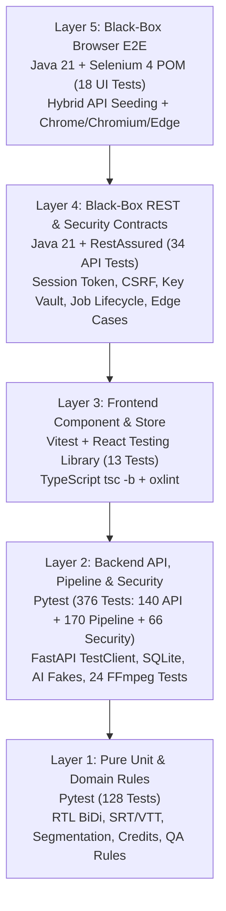
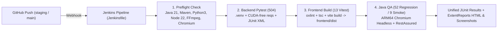

# SubBuild Studio — Enterprise QA Architecture & Test Plan

## 1. Executive Summary & QA Strategy

SubBuild Studio is an AI-powered local video subtitling, transcription, synchronization, and translation workbench built on **FastAPI + SQLite (SQLModel)** and **React 19 + TypeScript + Vite 8**. Testing an application that combines local FFmpeg media pipelines, GPU/CPU Whisper models, multi-provider LLM/Vision calls (Google Gemini, OpenAI, Anthropic, Ollama), and a virtualized interactive studio UI requires a **Multi-Layer Hybrid Test Pyramid** rather than relying solely on slow UI tests or mocked unit tests.

Our QA strategy separates deterministic white-box verification from black-box system validation:

- **In-Process Python & Frontend Suites (`pytest` + `vitest`):** Execute fast, isolated unit, API, pipeline, and security tests using deterministic AI provider fakes (`FakeTranslator`, `SlowTranscriber`), temporary SQLite storage (`_TEST_STORAGE`), and controlled FFmpeg clips.
- **Black-Box Java QA Automation (`qa-automation-java/`):** Treats SubBuild Studio as a live deployed system using **Java 21 + JUnit 5 + Selenium WebDriver 4 (POM) + RestAssured**, validating HTTP security contracts, CORS/CSRF protections, session cookie bootstrap, and end-to-end browser workflows across Chrome/Edge without touching internal Python code or production data.

---

## 2. Hybrid Test Pyramid Architecture



### Why Hybrid API + UI Automation?
Running full Whisper transcription and AI translation through a browser UI for every UI test would take minutes per test and introduce GPU/network flakiness. Instead, `StudioEditorUiTest` uses a **Hybrid API + UI pattern**:
1. A deterministic 4-second synthetic `.mkv` containing an embedded SRT track is generated once per session via `ffmpeg`.
2. `SubBuildApiClient` (RestAssured) creates and polls a job to `COMPLETED` via `use_embedded_subtitles=true` in under 2 seconds.
3. Selenium WebDriver opens the browser via the one-time `/?token=...` bootstrap link, selects the completed project, and tests real DOM interactions (inline editing, segment insertion, search/replace, undo/redo history, QA panel, export toolbar).

---

## 3. Suite Breakdown & Directory Layout

### 3.1 Python Backend Test Suite (`backend/tests/`) — 504 Tests
Configured in [`backend/pytest.ini`](../backend/pytest.ini) with `pythonpath = .` and automated directory-based tagging in [`backend/tests/conftest.py`](../backend/tests/conftest.py).

| Layer / Marker | Directory | Files | Collected Tests | Scope & Isolation |
|---|---|---:|---:|---|
| `@pytest.mark.unit` | `backend/tests/unit/` | 12 | 128 | Pure logic with zero DB or FFmpeg: RTL BiDi (`test_rtl_fixer.py`), SRT/VTT serialization & timestamp carry (`test_srt_formatter.py`), segmentation & orphan-word healing (`test_refine_stage.py`, `test_refine_quality.py`), end-credits detection (`test_credits_detect.py`), speaker split & SDH (`test_speaker_split.py`), missing speech (`test_missing_speech.py`), QA rules (`test_qa.py`), desktop launcher & shortcuts (`test_desktop_launcher.py`, `test_create_shortcut.py`), DB migration (`test_legacy_rename.py`). |
| `@pytest.mark.api` | `backend/tests/api/` | 13 | 140 | FastAPI `TestClient` + isolated SQLite: job lifecycle & live segments (`test_api_and_pipeline.py`), multi-provider key vault, strict filtering, Ollama `/api/show` capability discovery, OpenAI snapshot deduplication, startup discovery guard, GPT-5.4/GPT-6 pricing & mixed-provider runtime (`test_multi_provider_ai.py`), segment CRUD (`test_insert_segment.py`), undo/redo edit history (`test_edit_history.py`), upload deduplication & SHA-256 cache (`test_media_upload.py`), row-scoped retranslation (`test_row_translate.py`), glossary profiles (`test_glossary_profiles.py`), speaker detection (`test_speaker_detect.py`), retime/reorder (`test_retime.py`), settings/pricing (`test_settings_pricing.py`), review fixes (`test_review_fixes.py`), save next to video (`test_save_next_to_video.py`), storage cleanup (`test_storage_cleanup.py`). |
| `@pytest.mark.pipeline` | `backend/tests/pipeline/` | 13 | 170 | Pipeline orchestration & AI adapters: full E2E clip (`test_pipeline_e2e.py`), Whisper threading/OOM/cancel (`test_whisper_provider.py`), Gemini/LLM retries/glossary/truncation (`test_gemini_provider.py`), Flex tier fallback (`test_flex.py`), FinOps dHash prefilter & Ollama pre-tagging (`test_finops_optimizations.py`), OCR & tactical comms (`test_comms_onscreen.py`), foreign speech (`test_foreign_speech.py`), sync alignment & burned-in detection (`test_sync.py`), gap recovery (`test_gap_recovery.py`), word snapping (`test_word_snap.py`), video embedding (`test_embed_video.py`), embedded tracks (`test_embedded_subtitles.py`), per-job logging (`test_logs.py`). |
| `@pytest.mark.security` | `backend/tests/security/` | 5 | 66 | Defense-in-depth verification: `X-SubBuild-Token` & cookie bootstrap + UNC path refusal (`test_session_auth.py`), Origin/Fetch-Metadata CSRF guard & `TrustedHostMiddleware` (`test_request_guard.py`), CSP & anti-framing headers (`test_security_headers.py`), FFmpeg `-protocol_whitelist file` & AST bare `-i` audit (`test_ffmpeg_safety.py`), `Content-Length` upload limits & filename sanitization (`test_upload_limits.py`). |
| Shared Fixtures | `backend/tests/fixtures/` | 2 | — | `builders.py` (`insert_job`, `create_job_with_segments`, `wait_for_job`) and `fakes.py` (`FakeTranslator`, `SlowTranscriber`). |

Additional cross-cutting Pytest markers:
- `@pytest.mark.smoke` (**53 tests**): Critical-path sanity checks across auth, core API, pipeline E2E, RTL, and SRT/VTT formatting.
- `@pytest.mark.ffmpeg` (**24 tests**): Tests invoking real `ffmpeg`/`ffprobe` binaries.
- `@pytest.mark.regression` (**504 tests**): Full regression coverage.

### 3.2 Frontend Test & Static Analysis Suite (`frontend/`) — 13 Tests
- **Static Checks:** `oxlint` (`npm run lint`) and TypeScript compiler (`tsc -b`).
- **Component & Store Tests:**
  - `frontend/src/__tests__/reliability_and_editor_roundtrip.test.tsx` (**9 tests**): autosave state, split/merge/shift controls, search navigation, and bilingual export URL generation.
  - `frontend/src/__tests__/multi_provider_settings.test.tsx` (**4 tests**): multi-key provider vault tabs, Ollama Cloud preset, strict key & task filtering, per-episode/movie cost benchmarks, `RowTranslateDialog` model filtering & provider-conditional Thinking selector, `ExportToolbar`/`Sidebar` multi-stage AI status without Gemini keys, and GPU/VRAM-aware Best-Value Auto-Selector (with Google Flex support).

### 3.3 Java Enterprise Black-Box Automation (`qa-automation-java/`) — 52 Tests
Standard Maven project built with **Java 21**, **JUnit 5**, **Selenium WebDriver 4.27**, **RestAssured 5.5**, and **ExtentReports 5** (`9 @Tag("smoke")` + `43` additional `@Tag("regression")` tests; every `smoke` test also carries `@Tag("regression")` so `-Pregression` runs the complete 52-test suite).

```text
qa-automation-java/
├── pom.xml                                   # Maven profiles: -Psmoke (9) & -Pregression (52)
└── src/
    ├── main/java/com/subbuild/qa/
    │   ├── api/
    │   │   └── SubBuildApiClient.java        # RestAssured client with X-SubBuild-Token, keys & job seeding
    │   ├── config/
    │   │   └── TestConfig.java               # Auto-headless CI & Linux ARM64 Chromium/driver resolution
    │   ├── driver/
    │   │   └── DriverFactory.java            # Chrome/Chromium/Edge factory (headless/headed, implicitWait=0)
    │   └── pages/
    │       ├── BasePage.java                 # Explicit WebDriverWait primitives (zero Thread.sleep)
    │       ├── HelpPage.java                 # Help & Q&A guide view, FAQ accordion & back navigation
    │       ├── IngestPage.java               # Bootstrap login, mode switch, media probe, presets, launch
    │       ├── StudioEditorPage.java         # SubtitleTable, Insert/Glossary/Shift-Time, Search, Undo/Redo, QA
    │       ├── ExportToolbarComponent.java   # Live onscreen position, SRT/VTT/Log/Glossary/Embed controls
    │       ├── SettingsPage.java             # Multi-provider keys, per-step provider/model, warnings, RTL/Theme
    │       └── SidebarComponent.java         # Project navigation, Clear All & bulk selection
    └── test/java/com/subbuild/qa/
        ├── base/
        │   ├── BaseApiTest.java              # Injects isolated server & SubBuildApiClient
        │   └── BaseTest.java                 # WebDriver per-test lifecycle & studio bootstrap
        ├── extensions/
        │   ├── SubBuildServerExtension.java  # Isolated uvicorn launcher + temp STORAGE_DIR + FFmpeg fixture
        │   └── ExtentReportExtension.java    # ExtentReports HTML dashboard + auto-screenshot on failure
        └── tests/
            ├── api/
            │   ├── SystemAndSecurityApiTest.java  # 14 tests (Auth 401, CSRF 403, UNC 400, headers, estimates)
            │   ├── JobLifecycleApiTest.java       # 2 tests (Embedded pipeline E2E, CRUD/history/QA/exports)
            │   └── RegressionApiTest.java         # 18 tests (Split/Merge/Shift, Glossary, Key Vault, Mixed Estimate, Embed)
            └── ui/
                ├── IngestAndPresetsUiTest.java    # 6 tests (Modal, ModeSwitch, Probe, 4 Genre Presets, Launch)
                ├── StudioEditorUiTest.java        # 2 tests (Hybrid seeded workspace, Insert/Replace/Undo/QA/Clear)
                ├── SettingsUiTest.java            # 2 tests (RTL/LTR, Dark/Light, Metric/Cost-Saver/Flex persistence)
                └── RegressionUiTest.java          # 8 tests (Invalid path, Sync SRT, Overlap, Multi-Key, Warnings, Help)
```

---

## 4. Test Data & Environment Isolation

All automated test suites strictly protect real user data (`backend/storage/subbuild.db`) and credentials (`backend/.env`):
- **Pytest (`backend/tests/conftest.py`):** Points `STORAGE_DIR` and `DATABASE_URL` to a fresh `tempfile.mkdtemp(prefix="subbuild_test_")` before importing any `app.*` module, sets `GEMINI_API_KEY=""`, and removes the directory on `pytest_sessionfinish`.
- **Java Automation (`SubBuildServerExtension`):** Automatically launches an isolated `uvicorn app.main:app` instance on a free dynamic loopback port (`127.0.0.1:<port>`) with a dedicated `subbuild_qa_java_*` temp `STORAGE_DIR`, isolated SQLite DB, ephemeral `SUBBUILD_TOKEN`, and `GEMINI_API_KEY=""`. On suite teardown (`CloseableResource`), the server process tree and temp directory are cleaned up automatically.

---

## 5. Execution Guide

### Backend (`backend/`)
```powershell
cd "backend"

# Full regression suite (504 tests)
.\.venv\Scripts\python.exe -m pytest -q

# Fast targeted layers
.\.venv\Scripts\python.exe -m pytest -m smoke -q
.\.venv\Scripts\python.exe -m pytest -m unit -q
.\.venv\Scripts\python.exe -m pytest -m security -q
.\.venv\Scripts\python.exe -m pytest -m api -q
.\.venv\Scripts\python.exe -m pytest -m pipeline -q
.\.venv\Scripts\python.exe -m pytest -m "pipeline and not ffmpeg" -q
```

### Frontend (`frontend/`)
```powershell
cd "frontend"
npm run lint
npm test
npm run build
```

### Java Black-Box E2E & API (`qa-automation-java/`)
```powershell
cd "qa-automation-java"

# Full regression suite (52 tests, headless Chrome, auto-starts isolated backend)
mvn clean test -Pregression

# Fast smoke suite (9 critical-path tests)
mvn test -Psmoke

# Direct JUnit 5 @Tag filtering also works
mvn test -Dgroups=regression   # All 52 regression tests (includes the 9 smoke tests)
mvn test -Dgroups=smoke        # 9 critical-path smoke tests

# Run headed on Microsoft Edge or against an existing server
mvn test -Dsubbuild.browser=edge -Dsubbuild.headless=false
mvn test -Dsubbuild.baseUrl=http://127.0.0.1:8000 -Dsubbuild.token=your-token

# Cross-platform / ARM64 explicit overrides (auto-detected on Linux aarch64 by default)
mvn test -Pregression -Dsubbuild.headless=true -Dsubbuild.timeoutSeconds=30 \
  -Dsubbuild.chromeBinary=/usr/bin/chromium -Dsubbuild.chromeDriver=/usr/bin/chromedriver \
  -Dsubbuild.python=/path/to/backend/.venv/bin/python3
```

### Visual Test Reports
After running `mvn test`, open the generated ExtentReports dashboard:
- `qa-automation-java/target/reports/subbuild-qa-report.html` (includes category filters for `smoke`, `regression`, `api`, `ui`, `security`, execution timings, and embedded PNG failure screenshots under `target/reports/screenshots/`).
- Standard JUnit XML reports for CI/CD integration are written to `qa-automation-java/target/surefire-reports/`.

---

## 6. Risk-Based Test Matrix (`smoke` vs `regression`)

| Risk Area | Python Verification | Java Black-Box Verification | Tag |
|---|---|---|---|
| Session Token & Cookie Auth | `test_session_auth.py` | `SystemAndSecurityApiTest#protectedEndpointsRequireSessionToken` | `smoke` |
| Security Headers & CSRF Origin Guard | `test_security_headers.py`, `test_request_guard.py` | `SystemAndSecurityApiTest#systemInfoReturnsCatalogAndSecurityHeaders`, `#crossOriginStateChangesAreBlocked` | `smoke` / `regression` |
| UNC / Path Traversal / FFmpeg SSRF | `test_session_auth.py`, `test_ffmpeg_safety.py`, `test_upload_limits.py` | `SystemAndSecurityApiTest#networkPathsAreRejected` | `regression` |
| Media Probe & Embedded Pipeline E2E | `test_pipeline_e2e.py`, `test_embedded_subtitles.py` | `JobLifecycleApiTest#embeddedJobLifecycleAndExport`, `IngestAndPresetsUiTest#launchEmbeddedJobFromUi` | `smoke` / `regression` |
| Genre Presets & Cost Estimation | `test_settings_pricing.py`, `test_finops_optimizations.py` | `IngestAndPresetsUiTest#genrePresetsUpdateActiveBadge`, `SystemAndSecurityApiTest#costEstimateCalculation` | `regression` |
| Studio Editing, Undo/Redo, QA & Exports | `test_edit_history.py`, `test_insert_segment.py`, `test_qa.py` | `StudioEditorUiTest#openSeededJobAndUpdateOnscreenPosition`, `#insertReplaceUndoRedoQaAndSidebarCleanup` | `smoke` / `regression` |
| RTL Localization, Theme & Settings Persistence | `test_rtl_fixer.py`, `test_settings_pricing.py`, `test_flex.py` | `SettingsUiTest#languageThemeAndTogglesPersist`, `#flexAndOnscreenPositionPersist` | `smoke` / `regression` |
| Split/Merge/Shift, Glossary Profiles & Bilingual Export | `test_retime.py`, `test_glossary_profiles.py`, `test_srt_formatter.py` | `RegressionApiTest#splitMergeAndShiftSegmentsWithHistory`, `#glossaryUpdateAndSeriesProfilePersistence`, `#bilingualAndRtlExportContract`, `RegressionUiTest#glossaryDialogSavesCharacterAndProfile`, `#shiftTimePopoverPersistsTimingChange` | `regression` |
| Negative Input Validation, Overlap Guard & Soft Video Embed | `test_insert_segment.py`, `test_embed_video.py`, `test_upload_limits.py` | `RegressionApiTest#negativeSegmentValidationAndOverlaps`, `#negativeJobAndSettingsErrors`, `#negativeNonMediaPathsRejected`, `#jobLogExportAndSoftEmbed`, `RegressionUiTest#invalidMediaPathShowsErrorBanner`, `#insertDialogBlocksOverlappingSegment` | `regression` |
| Sync SRT Upload & Help FAQ Flow | `test_sync.py`, `test_logs.py` | `RegressionUiTest#syncModeSubtitleUploadAndEncodingSelector`, `#helpScreenAndFaqAccordion` | `regression` |
| Multi-Provider Key Vault, Mixed Settings & Pricing Benchmarks | `test_multi_provider_ai.py`, `test_settings_pricing.py` | `RegressionApiTest#multiProviderKeyVaultMasksSecretsAndManagesDefaults`, `#mixedProviderSettingsAndCostEstimateAcrossProviders`, `#catalogExposesEpisodeAndMovieBenchmarksAndSuitabilityWarnings`, `RegressionUiTest#multiProviderKeysAddAndManageInSettingsUi`, `#mixedProvidersWarningAndEpisodeBenchmarksInSettingsUi` | `regression` |

---

## 7. CI/CD Architecture (Jenkins on Raspberry Pi 4 ARM64 & GitHub Actions)

SubBuild Studio runs automated verification across both cloud CI (**GitHub Actions**) and a self-hosted **Jenkins** controller running on a **Raspberry Pi 4 (8GB, Debian `aarch64`)** triggered automatically by **GitHub Webhooks** on pushes to `staging` and `main`.



### Key Cross-Platform Engineering Decisions
1. **ARM64 Chromium & ChromeDriver Resolution ([`TestConfig.java`](../qa-automation-java/src/main/java/com/subbuild/qa/config/TestConfig.java), [`DriverFactory.java`](../qa-automation-java/src/main/java/com/subbuild/qa/driver/DriverFactory.java)):**
   - Google Chrome for Testing does not publish official Linux `aarch64` builds, so Selenium Manager cannot auto-download Chrome/ChromeDriver on Raspberry Pi.
   - `TestConfig` preserves normal Selenium Manager resolution on Windows and `x86_64` GitHub Actions (`ubuntu-latest` with `/usr/bin/google-chrome`), while automatically detecting OS-packaged `/usr/bin/chromium` (`chromium-browser`) and `/usr/bin/chromedriver` on Linux `aarch64` or Chromium-only containers.
2. **Automatic Headless Detection:**
   - Unless `-Dsubbuild.headless=false` is explicitly provided, `TestConfig.headless()` automatically enables `--headless=new` whenever `CI`, `JENKINS_URL`, or `GITHUB_ACTIONS` is set, or on display-less Linux (`DISPLAY` and `WAYLAND_DISPLAY` unset), preventing browser startup failures in headless CI while keeping local headed debugging effortless.
3. **Frontend Build Ordering before Selenium UI Tests:**
   - [`backend/app/main.py`](../backend/app/main.py) mounts the React SPA from `frontend/dist` only when that directory exists. [`Jenkinsfile`](../Jenkinsfile) runs `npm ci`, `npm run lint`, and `npm run build` (`tsc -b && vitest run && vite build`) **before** launching the Java suite so Selenium exercises the real production bundle served by FastAPI.
4. **Raspberry Pi / Debian Agent Prerequisites:**
   - OS packages (`aarch64` 64-bit Linux): `openjdk-21-jdk`, `maven`, `python3`, `python3-venv`, `ffmpeg`, `chromium`, `chromium-driver`, and **Node.js 22**.
   - [`Jenkinsfile`](../Jenkinsfile) filters out `^nvidia-` packages into `.venv/requirements-ci.txt` (keyed by SHA-256 of `backend/requirements.txt`) so both ARM64 Raspberry Pi and CPU-only `x86_64` agents avoid downloading CUDA runtimes and reuse the cached virtualenv across builds.
5. **Artifact & Test Reporting in Jenkins:**
   - `post { always }` publishes combined JUnit results from `backend/.pytest_cache/pytest-junit.xml` and `qa-automation-java/target/surefire-reports/*.xml`, and archives `qa-automation-java/target/reports/**` (`subbuild-qa-report.html` + failure screenshots).
